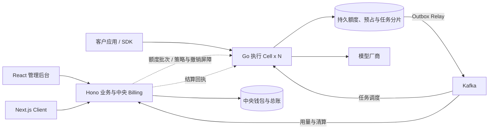

# 三系统架构与模块职责

更新日期：2026-11-01。版本：10 万并发目标架构。

管理业务系统掌握身份、价格、中央资金和正式账本；Go 数据平面在已授权的持久额度子池内完成请求准入、文本流式和图片/视频任务；Client 提供公开展示与个人/企业门户。目标为三组十万并发联合验收，正确扣费为底线。

核心技术为管理后台 React + Vite、Client Next.js、业务后端 TypeScript + Hono、Gateway Go。总体目标与故障模型见 [高并发架构](<AI Token SaaS 10万并发架构设计方案.md>)，工程配套见 [技术选型](<AI Token SaaS 最终技术选型方案.md>)。

## 系统边界与执行 Cell

| 系统 | 运行单元 | 核心责任 | 权威存储 |
| --- | --- | --- | --- |
| 管理业务系统 | 平台管理端、Hono API、分配与清算/支付 Worker | 身份、策略、价格、钱包、授权额度、预算、支付、原始结算与总账 | business_db 高可用部署 |
| LLM Gateway | Go API、额度执行、文本适配、媒体调度/回调/恢复、Relay | 本地持久准入、执行权、三类任务、可靠用量与回执应用 | runtime_db_<cell> 分片 |
| Client | Next.js 公开页与登录门户 | 客户自助业务、Playground、媒体任务与财务展示 | 通过 Hono/Gateway API，不直接写库 |

三系统是逻辑职责，不是固定三个进程。Go 执行 Cell 包含独立容量和持久状态，支持水平扩容；中央分配/清算从管理业务工程独立配置资源。额度执行仍属于 Gateway，正式账本仍属于 Billing。



客户生产推理直接访问 Gateway。正常命中已授权子池的请求不逐笔调用 Hono；首次加载、额度补充、屏障与异步清算通过明确内部契约交互。管理端与 Client 使用不同会话受众，服务端执行资源授权。

## 租户身份与资源模型

采用统一身份模型：User 表示自然人账户，Tenant 表示资源和资金归属主体，Membership 表示用户在某个租户的角色。Tenant 类型包括 personal 与 organization。一个 User 可以拥有个人租户并加入多个企业租户。

```text
Tenant
├── Wallet / Price Contract / Policies
├── Memberships → Users / Roles
└── Projects
    └── Applications / Service Accounts
        └── API Keys
```

Key 固定归属一个租户、项目和应用；生产应用优先使用服务账号。成员离职撤销其管理权限和个人凭证，企业服务账号的生命周期由企业管理员管理。

| 角色 | 允许的主要操作 | 资源范围 |
| --- | --- | --- |
| 平台运营管理员 | 租户启停、模型渠道、公开价格、运营配置 | 获授权的平台资源 |
| 平台财务 | 到账对账、退款、账务调整与成本报表 | 账务数据与必要客户资料 |
| 租户 Owner | 企业所有权、成员、支付和全租户策略 | 当前租户 |
| 租户 Admin | 项目、应用、Key、预算与成员管理 | 获授权租户或项目 |
| Developer | 调用接入、项目 Key、用量排查 | 获授权项目 |
| Billing | 充值、账单、消费报表 | 当前租户的财务资源 |
| Auditor | 只读审计与合规导出 | 明确授权的数据范围 |

费用查看、内容日志查看、凭证管理、价格修改与账务调整分别授权。平台支持人员临时访问客户敏感数据时，需要记录授权人、原因、范围与有效期。

每次 Client 切换租户后，服务端重新校验 Membership。请求路径中的 tenant_id 仅表示目标资源；授权依据是已认证用户、当前成员关系和资源归属。Gateway 从平台 Key 解析资源归属，不采用客户自报的 tenant_id 或 metadata 作为资金归属。

## 管理业务系统模块

| 模块 | 责任与输出 |
| --- | --- |
| Identity / Tenancy | 用户、个人/企业租户、成员、项目、应用、服务账号、会话和角色 |
| Access / Policy | Key 生命周期、模型/渠道范围、版本化限制、服务许可与撤销确认屏障 |
| Catalog / Pricing | 模型能力、供应商与凭证引用、销售/采购价格、上界规则、最终计价与合同 |
| Quota Allocation | 当前状态、钱包、来源、全部硬预算的批次授权与安全回收 |
| Billing | 原始结算、最终客户费用、中央余额、平衡总账、消费退款与对账 |
| Payments | 订单、支付尝试/到账、来源与原路退款，外部结果核实 |
| Usage / Operations | 带水位的查询投影、账单、通知、审计、差异处理与运营 |

中央账户、来源、预算分配、结算和总账通过 Billing 统一事务接口维护。Go 请求预占位于自己的运行时事务域，依靠中央已经占用的授权守住资金上限；两库不假装共享事务。

最终收费算法统一在 Billing，Gateway 只执行发布的计价上界及额度约束。中央停止新授权不阻止合法历史结算。分配、清算、门户与报表分别设置连接池、并发及观测，避免管理工作阻塞资金服务。

## Gateway 数据平面模块

| 模块 | 处理规则 |
| --- | --- |
| 协议与请求校验 | 文本非流式/SSE、平台图片/视频任务 API，能力/参数/大小/输出上限明确 |
| 本地鉴权 | 必要身份投影、有效服务许可、policy_epoch 与租户资源范围 |
| 分片路由与幂等 | 固定虚拟分片、原请求/任务归属、分片再均衡，不能随机换 Cell 重做收费意图 |
| 额度执行 | 激活 quota_pools，在本地事务预占/启动/未执行释放，应用清算回执与封存回收 |
| 流控与公平性 | 租户/项目/Key、模型、供应商的速率和并发分层保护，不能用速率限流代替资金约束 |
| 路由与适配 | 在授权渠道内选择，维护健康、熔断、请求/响应/错误与用量映射 |
| 文本执行 | 直接流式转发、有界缓冲、超时取消、发送资格与未知恢复 |
| 媒体任务 | 持久受理、公平调度、厂商提交、回调/轮询、取消核对与文件保存状态 |
| 事实与派发 | 原始/标准用量、厂商尝试、Outbox、清算意图与 Inbox 回执 |
| 恢复与观测 | 悬挂资金、未知提交、重复乱序事件、Cell 负载、准入与清算延迟 |

额度执行统一封装为 Go 的 internal/quota 领域模块，Gateway API、媒体与恢复 Worker 复用同一实现，并直接在所属运行时分片内完成事务。请求准入通过进程内函数调用，不增加独立额度 RPC。

每份授权绑定持久分片，不绑定 Pod。多个进程共享同一份持久权威并通过事务协调，不能各维护可独立消费的内存余额。文本与媒体 Worker 分离资源，上游提交结果未知不会自动改回待执行。

## Client 功能模块与接入方式

| 页面或模块 | 普通用户能力 | 企业附加能力 |
| --- | --- | --- |
| 账户与首页 | 注册登录、余额、用量、快速接入 | 企业切换与企业概览 |
| 模型与价格 | 模型能力、销售价格、示例 | 企业协议价与企业可用模型 |
| 项目与应用 | 个人应用与环境 | 企业项目、服务账号、成员授权 |
| API Key | 创建、复制一次、限制、撤销 | 项目授权、集中管理、批量失效 |
| 预算与用量 | 消费限制、用量明细、告警 | 多级预算、成本归属和项目报表 |
| 媒体任务 | 图片/视频提交、进度、取消、文件与收费状态 | 企业项目归属、预算与任务审计 |
| 钱包与订单 | 充值、支付状态、退款申请 | 企业充值与财务权限 |
| 账单 | 明细、账单下载、发票申请 | 企业抬头、合同、财务导出 |
| 组织与~~安全~~ | 账户安全与个人租户设置 | 成员、角色、邀请、企业策略与审计 |
| 开发者中心 | 文档、示例、错误解释、状态查询 | 企业接入指南与服务账号示例 |

浏览器使用受保护的登录会话调用业务 API，采用安全 Cookie、CSRF 防护和受控跨域策略。平台 Key 的创建明文只在首次成功响应展示，常规列表返回掩码和元数据。

Playground 由业务 API 签发短期、限制模型/额度/用途的调用授权，绑定用户和租户并纳入同一计量链路。客户生产应用使用自己的服务端保管长期 Key；前端静态包与日志不包含厂商凭证。

门户余额分列已入账、中央可再分配、子池可用、请求冻结和待入账，标注更新时间与水位。查询投影不参与资金准入。

## Gateway 所需的上下文

Gateway 无需用户注册、邀请和角色编辑表。示例中的资源、预算与账户由可信 Key 和控制面投影关联，客户自报 tenant_id/metadata 不能决定资金归属。

```json
{
  "tenant_id": "tenant_example",
  "project_id": "project_example",
  "application_id": "app_example",
  "key_id": "key_example",
  "billing_account_id": "account_example",
  "home_shard_id": "shard_example",
  "routing_version": 3,
  "policy_epoch": 12,
  "scope_fingerprint": "scope_example",
  "allowed_models": ["text-example", "image-example", "video-example"],
  "limits": {"rpm": 100, "max_concurrency": 10}
}
```

控制面撤销先为 REVOKING。可服务分片与本地准入有序地持久应用禁用并 ACK，全部确认或得到可验证隔离证据后才 REVOKED。服务许可过期停止新准入；历史已获准入默认完成，紧急取消另留结果和成本证据。

## 资金与可用性边界

中央分配满足已入账余额覆盖全部未结清委托和退款冻结；本地满足 L=F+H+X+R。中央消费事务同时扣 P/D 和写账，回执到原分片后才释放 E-C。异步是可靠清算与回执，不是允许超余额执行后补查。

Hono 暂不可用时，仅在已有额度、有效服务许可及安全积压水位内继续新准入；额度不足或许可过期则暂停。运行时持久化不可确认时，受影响 Cell 停止新付费执行；已发未知保留冻结。中央和运行时主库都遵守同步确认与安全提升策略。

## 部署结构

| 运行单元 | 部署要求 |
| --- | --- |
| 管理后台 | Vite 静态资源与受控 API 入口 |
| Client | Next.js 独立 Node.js 应用，公开内容与个性化数据缓存隔离 |
| Hono API / 分配 / 清算 / 支付 Worker | 同工程领域模块、分进程与资源预算，中央库唯一写入责任 |
| Gateway / 额度执行 / 媒体 Worker / 回调 / Relay | 按 Cell 与分片部署，流式排空、任务背压、持久执行权 |
| PostgreSQL | 中央 HA 库与运行时 HA 分片分别部署，独立角色、迁移与故障策略 |
| Kafka / Redis | 按 Cell 规划容量与故障域，资金去重在数据库，缓存丢失不生成余额 |
| 对象与分析存储 | 大文件与报表卸载，不进入资金准入事务 |

10 万有效流、10 万异步在途及合计十万混合场景按 [可靠性方案](07-reliability-and-validation.md) 验收，持续 QPS、延迟与故障余量另测。表与事务见 [数据库](03-database-design.md) 和 [账务](04-billing-and-ledger.md)，中央/运行时契约见 [接口](05-api-contracts.md)。
