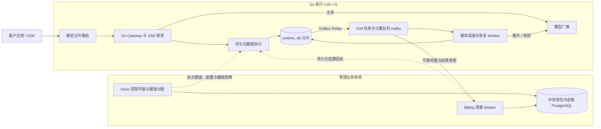

# AI Token SaaS 10万并发架构设计方案

更新日期：2026-11-01。状态：高并发目标设计与实施验收基线。10 万并发是容量目标，实际吞吐、延迟和故障恢复能力须按本文验收。

平台面向企业和普通用户，覆盖文本非流式与 SSE、图片异步生成、视频异步生成。管理后台 React + Vite、Client Next.js、业务后端 TypeScript + Hono、LLM Gateway Go 构成平台核心技术栈。资金正确性是准入条件：不能超授权消费、重复扣款、错误释放冻结或用估算冒充精确收费。

本方案采用控制平面、Go 执行 Cell、持久化额度子池、异步任务引擎与中央 Billing。正常命中有效授权的请求，在数据平面的短事务中完成请求预占和启动，不逐请求同步调用 Hono。中央 Billing 按批分配额度，统一计算最终客户费用并记账。

## 目标与容量口径

| 场景 | 验收规模 | 口径 |
| --- | --- | --- |
| 文本流式边界 | 100,000 条活跃 SSE | 真实转发内容与计量，不以空闲连接代替有效流 |
| 媒体任务边界 | 100,000 个异步在途任务 | 包含 QUEUED、DISPATCHING、SUBMITTED、RUNNING、SUBMISSION_UNKNOWN，分别统计 |
| 混合负载 | 文本流与媒体在途任务合计 100,000 | 固定文本/图片/视频比例、时长、输出大小与单企业占比 |

三组是独立验收场景，不等于同时承诺 20 万任务，也不等于 10 万 QPS。稳态同类工作负载可用 并发量 ≈ 到达率 × 平均在途时长 校验测试模型；排队时间与模型运行时间分别记录。持续新请求 QPS、最大单企业 QPS、流时长、媒体大小和上游采购并发需在压测配置中固定。

平台受理能力、厂商执行配额和实际生成算力分别核算。文本请求超过允许的等待和上游容量时明确拒绝；媒体任务按持久队列、公平调度和截止时间受理。

## 三系统与运行单元

| 逻辑系统 | 运行单元 | 权威状态 |
| --- | --- | --- |
| 管理业务系统 | 管理前端、Hono API、额度分配服务、Billing/支付 Worker | 身份、租户、策略发布、价格、中央钱包、资金来源、预算分配、结算与正式账本 |
| LLM Gateway | Go API、额度执行模块、文本适配器、媒体调度/回调/恢复 Worker、Outbox Relay | 已获授权额度的子账、请求预占、执行权、任务、厂商尝试、用量与待发事实 |
| Client | Next.js 公开页面与用户门户 | 页面与交互；业务状态通过 API 获取 |

Gateway 不管理用户注册、企业成员和角色编辑。它消费可信 Key 归属、模型/渠道、策略、计价和预算上下文。额度执行统一封装为 Go 进程内 internal/quota 模块，Gateway API、媒体与恢复 Worker 复用同一实现，直接操作所属运行时分片；跨 Cell 不共享可独立消费的额度副本。



Cell 是独立扩缩容和隔离故障的执行组，拥有自己的持久运行状态、队列资源与限流保护。中央控制与清算是公共依赖；故障时可服务范围受已分配额度、服务许可有效期及积压水位共同限制。消息集群若跨 Cell 共享，必须单独标明共同故障域，不能宣称完全隔离。[Cell 架构参考](https://docs.aws.amazon.com/wellarchitected/latest/reducing-scope-of-impact-with-cell-based-architecture/what-is-a-cell-based-architecture.html)

## 中央钱包与额度子账

中央钱包保存 posted_balance、delegated_balance 和 refund_held_balance。中央可再分配金额为 posted_balance - delegated_balance - refund_held_balance。额度分配不是消费，也不产生收入分录。

每个 quota_grants 授权绑定租户、币种、一个资金来源、完整硬预算窗口集合、home_shard_id、binding_epoch、允许范围与新准入截止时间。大企业可有多个子池并行消费；每次分配都在中央事务中同时占用账户、资金来源和所有适用预算的可分配空间。

每个持久 quota_pools 子池保存以下金额：

| 字段 | 含义 |
| --- | --- |
| L / allocated_amount | 原始授予金额，固定 |
| F / free_amount | 还可用于新请求的金额 |
| H / held_amount | 请求占用，包含等待用量与清算回执的冻结 |
| X / confirmed_charged_amount | 已应用中央回执的累计消费，不因消费退款而改写 |
| R / sealed_return_amount | 已封存用于归还的金额，包含回收确认在途部分，禁止再用于请求 |

```text
中央：posted_balance >= delegated_balance + refund_held_balance >= 0
预算：consumed_amount + delegated_amount <= limit_amount
子池：L = F + H + X + R
中央单份授权：L = posted_amount + returned_amount + outstanding_amount
```

例如余额 1000，向两个执行分片各分配 100，中央可再分配金额为 800；分片只能在各自 100 内申请子预占。命中有效子池时，一次请求不再争用中央钱包行。

请求可能从同一执行分片的多个同范围授权切片中预占，切片顺序、金额、来源与预算引用在准入时冻结。每份授权绑定单一资金来源，以支持退款追踪；不得借用其他项目、Key、币种、预算窗口或分片的子池。

最终收费计算仅在 Billing 执行。Go 根据发布的计价上界规则计算 E 并预占，保留可靠计量；Billing 根据冻结版本算 C，要求 0 <= C <= E。普通完成任务在回执落地前继续冻结 E；回执应用后消费 C，剩余 E-C 回到原子池。不得把已经消费的 C 再补回 free_amount。

中央入账后、回执应用前，两边投影会有在途差额。不能把该差额当成可补发资金。对齐事件水位后按回执和回收在途项对账；静止收敛时 X 等于中央 posted_amount，R 等于中央 returned_amount，outstanding_amount 等于 F+H。

## 授权生命周期与安全回收

授权中央状态使用 ALLOCATED、ACTIVE、DRAINING、CLOSED、QUARANTINED；本地子池使用 ACTIVE、DRAINING、CLOSED、QUARANTINED。授权已占用中央资金后，只有安全回收事务能释放它，状态超时不是释放证据。

1. Billing 以稳定 grant_request_id 在中央事务中创建授权并占用金额，写授权 Outbox；一次操作可按资金来源返回多份授权，重试返回原列表。
2. 本地按 grant_id 与内容摘要幂等激活，重复授权不能重置 F；同标识不同内容隔离核对。
3. 分片按水位申请新的独立授权。旧授权金额不可被原地改大；回执不等于新的补充授权。
4. 回收先把本地子池转 DRAINING，停止新预占，并持久封存可归还 F。R 增加后这些金额不能本地撤回。
5. 中央按 return_operation_id 去重，减少 outstanding 与 delegated，释放资金和原预算窗口的空间。
6. 仍有在途 H、未应用回执或未确认回收时保持 DRAINING；全部闭合后才 CLOSED。

截止时间到达只阻止新的预占。未启动请求可通过与启动竞争的原子取消释放；已启动、提交结果未知及仍在生成的视频不得自动解冻。跨期请求继续使用原预算窗口与价格。来源过期先停止新准入，不能重复释放在途资金。窗口和截止判断使用明确的分片时间基准及受监控时钟误差，偏差超出允许范围时停止新准入；撤销完成仍依靠持久屏障，不仅依靠时间。

授权绑定持久逻辑分片而非易失 Pod。故障 Cell 的额度不能根据心跳丢失直接复制到其他 Cell。无法证明旧状态与在途消耗时保持占用；接管 Cell 只能使用新的有效授权或完成受控分片再均衡后的原子池。

## 路由幂等与权限生效

公开业务幂等作用域统一为 tenant_id + application_id + operation_kind + Idempotency-Key。相同意图映射原 request_id/task_id 和原 home_shard_id；载荷变化返回冲突。无幂等键的重复推理是独立请求。追踪 request_id 与收费业务意图分开处理，不能仅按提示词去重。

虚拟分片映射带 routing_version。分片再均衡必须封存原写入权威、复制请求/幂等/额度/待发事件/回执状态、验证水位，再激活新归属。原归属不可用时返回可重试状态或原任务状态，不能随机换 Cell 新建同一收费意图。

binding_epoch 标识授权的执行分片绑定；shard_write_epoch 标识运行时分片可写者；executor_epoch 标识任务领取者；policy_epoch 标识权限投影版本。存储侧条件更新拒绝旧执行者的新写入。旧 epoch 已合法准入的事实和回执仍按历史绑定清算，不能一律丢弃。

Key/租户撤销在控制面持久化为 REVOKING，停止新授权并投递带 epoch 的屏障。各可服务分片在与准入有序的本地事务中落地禁用状态、确认屏障。全部目标确认或被可验证隔离后才返回 REVOKED。无法确认的分片不能靠一次缓存刷新或路由摘除被视为已经全局撤销；服务许可过期会停止新准入，资金仍保留。

默认已获准入请求可完成，紧急取消为独立动作；排队任务是否批量取消在操作中显式声明。政策、价格和能力快照有版本、生效区间和校验摘要，缺口通过持久游标及全量校验修复。

## 文本流式执行

1. 校验 Key 投影、服务许可、模型、参数、路由约束与流量限制，从可信上下文解析租户和账户。
2. 解析请求幂等归属，按固定顺序锁本地子池，冻结计价/预算/输出上限，写请求、request_reservations、reservation_slices 与执行意图。
3. 以持久条件转换取得唯一 attempt_id 的发送资格。未发送取消与启动在本地状态上原子竞争；同步持久化确认后才向上游发送。
4. 通过受控连接池直接转发 SSE，分离首 Token、流空闲与总截止时间，限制每流缓冲和慢客户端占用。正文不逐 Token 进入账务 RPC 或 Kafka。
5. 结束或中断时保存原始用量摘要、标准计量、实际交付情况及结算意图 Outbox。无可靠用量进入 RECONCILING，冻结继续有效。
6. Billing 异步出具结算回执，本地幂等更新子池和请求状态；客户已看到内容不代表总账已经入账。

SSE 断流后不透明拼接另一份生成。节点退出可能中断连接，不能承诺任意模型流无缝续传。执行结果未知时不自动重发；厂商幂等能力需针对具体接口验证。输入、输出、缓存、推理 Token 按厂商语义分类，子集字段不得重复相加。

## 图片与视频异步任务

任务受理事务同时完成请求幂等、费用上界预占、task_id、任务状态和 task.ready Outbox，达到持久化确认后才返回 202。队列暂不可用时依靠 Outbox 恢复；达到积压或存储水位时暂停新增受理。

```text
执行：QUEUED -> DISPATCHING -> SUBMITTED -> RUNNING -> SUCCEEDED / FAILED / CANCELED
提交结果未知：DISPATCHING -> SUBMISSION_UNKNOWN -> 查询恢复 / 人工核对
账务：RESERVED -> SETTLEMENT_PENDING -> POSTED
用量未知：RESERVED -> RECONCILING -> SETTLEMENT_PENDING
确认未执行：RESERVED -> RELEASED
```

QUEUED 期间已占用资金。取消或排队截止与领取发送资格在同一状态记录上竞争，只有确认未发送的一方可释放。DISPATCHING 后提交响应丢失时保存 SUBMISSION_UNKNOWN；不能直接改回 QUEUED 重发。

Worker 以模型、租户、上游配额和任务权重做有界公平调度。图片/视频与 SSE 使用独立资源池；待完成任务通过 next_poll_at 索引、延迟调度和退避查询恢复，不为每个任务维护长连接或忙轮询协程。

接收回调先验签、校验上游账户及 provider_job_id 与本地尝试映射，持久 Inbox 后响应，异步做状态转换。重复事件和不同事件 ID 的同一业务结果均须去重；迟到进度不能回退终态。轮询查询作为回调丢失的补充。[Webhook 重复与乱序说明](https://replicate.com/docs/topics/webhooks/receive-webhook)

图片按照数量、尺寸、质量等已声明计量项，视频按照时长、分辨率、帧率、音轨或模型固定单价等冻结规则计算上界和最终费用。具体计量字段以适配器能力清单为准，不能把不同厂商同名字段直接相加。

取消请求仅表示正在尝试取消。确认已执行的失败/取消也可能有费用，先核实结果与用量，再按客户合同结算；采购成本另记。不同供应商对取消的收费不同，例如 Replicate 区分未开始终止与开始后取消。[任务计费示例](https://replicate.com/docs/topics/predictions/lifecycle)

任务结果状态、文件保存状态和账务状态分别记录。图片/视频通过对象存储直传、引用及下载授权交付；文件搬运失败重试下载或保存，不重新发起生成。已有的在途任务不会因为授权新准入时间结束而被误判为零费用。

## 中央清算与对账

运行时用量与结算意图在同一事务落库，Outbox Relay 经确认的派发领取事务后投递 Kafka。Billing 按账户做有界小批处理，逐请求保留最终收费、切片与幂等记录。

Billing 验证授权、冻结价格/计量规则、可靠用量和原切片，计算一次 C，并按冻结切片顺序分配 C_i。一个中央事务完成：消费结算、平衡分录、posted_balance 与 delegated_balance 各减 C、各原预算窗口 delegated 减 C 且 consumed 加 C、资金来源扣减，以及结算回执 Outbox。每层预算记录同一消费，不产生多次钱包扣款。

运行时应用回执时原子完成 Inbox 去重、H 减 E、X 加 C、F 加 E-C 与请求状态更新。确认未执行且已本地释放的零收费回执仅确认账务状态，不再释放一次。异常金额、不同事实的重复结算或跨租户/币种切片进入冲突核对，保留约束。

最终收费逻辑统一在 Billing，前端只展示。上界规则、最终计价、单位映射、最小收费和舍入阶段都有版本与黄金样例。金额与单价采用 NUMERIC(30,12)，接口以字符串传递；E 向上舍入到存储精度，C 按冻结规则在规定阶段舍入。缺失计量不能静默按估算结账。

消费退款追加反向分录，原收费和子池累计 X 保持不变；退款金额重新进入中央资金来源，后续通过新授权消费。充值款原路退款先核验来源未占用金额；已分配金额先安全回收，在途资金不参与退款。

余额展示区分已入账余额、中央可再分配、子池可用、请求冻结、待入账和退款冻结。已分配未消费额度不是已消费；跨分片汇总是带水位与更新时间的查询投影，不用作准入依据。

## 数据与生产部署

| 存储或组件 | 目标部署与用途 |
| --- | --- |
| business_db | 独立高可用 PostgreSQL；钱包、来源、额度分配、预算、定价、结算、支付与正式账本 |
| runtime_db_<cell> | 按执行 Cell/分片部署的高可用 PostgreSQL；持久额度子账、请求、任务、执行权、用量与 Outbox |
| Kafka | 多副本、可靠确认的任务与事实通道；按执行 Cell 的容量和故障域分组 |
| Redis | Cell 内配置缓存、速率/并发控制；不能代替额度子账的资金权威 |
| 对象存储 | 图片、视频、文件与按配置保留的内容日志 |
| 分析存储 | ClickHouse，消费、延迟、用量与成本投影；不参与资金准入 |
| Kubernetes | 生产运行单元、容量隔离、调度与滚动发布；Compose 用于开发和小规模联调 |

生产采用单区域、多可用区与多个执行 Cell 的目标拓扑，业务总账库与运行时库分离资源及角色。逻辑库数量由执行分片数量决定；各逻辑分片的写入权威、运行角色、复制与故障策略明确配置。

Kafka 配置需验证多副本、acks=all、最小同步副本数和幂等生产者，消费端仍依赖业务唯一键。入队确认不等于总账入账；Outbox 与 Inbox 承担数据库和消息系统之间的恢复。[Kafka 可靠确认](https://kafka.apache.org/41/configuration/producer-configs/)

额度与记账事务的确认必须达到设计的同步持久化级别；普通主从不等于已确认写入不会丢失。默认故障模型至少覆盖单节点及单可用区故障；无法选出包含已确认记录的安全主库时停止新准入，禁止强制有损提升。跨区域灾难的 RTO/RPO 单独确定。[复制与故障转移约束](https://patroni.readthedocs.io/en/latest/replication_modes.html)

COMMIT 超时可能已提交且可见，但不一定已完成所需复制确认。恢复时不能仅凭普通 SELECT 读到记录就发放执行许可。准入确认、执行权领取、授权派发和资金回执派发都要通过同级持久化确认事务或经验证的 WAL 屏障再产生外部副作用。

## 性能隔离与容量管理

Gateway 按活跃流、内存、网络与准入延迟扩容；Worker 按可调度任务、上游并发与回调处理能力扩容。新增 Pod 不会自动迁移已建立 SSE，发布需要停止新流、排空和有界退出。

连接池复用并设置总上限。授权预取使用低水位、目标水位、每租户未用上限和请求合并，避免所有实例同时申请或囤积闲置资金。超额输出、无限排队、无限缓冲和逐 Token 金额舍入均不进入正常路径。

资金分配、清算和退款采用全系统一致的账户、预算、来源锁顺序，外部 HTTP 不放进数据库事务。索引按 tenant_id、状态、时间、水位和稳定业务标识组织；未清算事实、未完成回收、幂等墓碑不得随日志 TTL 删除。

## 故障行为与验收

| 场景 | 必须保持的行为 |
| --- | --- |
| Hono/中央 Billing 暂不可用 | 仅在已获额度、有效服务许可及安全水位内继续新准入；不能补发额度，回执等待期间保持冻结 |
| 运行时存储不可用 | 受影响 Cell 停止新增付费执行；不退回纯内存额度模式 |
| 额度所有者失联 | 原资金继续占用，旧写者被持久 fencing；不能凭 TTL 给另一 Cell 相同额度 |
| Kafka/清算积压 | 事实保留 Outbox，按空间和额度水位背压，不丢事件或提前解冻 |
| 提交成功但响应丢失 | 原标识查询；没有厂商可验证幂等时不自动重发 |
| 重复回调、结算和回执 | 同一收费及释放只生效一次，指纹冲突转核对 |
| Key 撤销时分片失联 | 返回 REVOKING 或已证实隔离的结果，不能伪报全局撤销完成 |
| 旧快照恢复 | 封存旧 epoch，核对未结清授权和已入账事实后才重开，不从旧快照复制出可消费额度 |

每组容量测试同时核对中央与子池资金等式、预算约束、每请求唯一收费和账本借贷平衡。必须包含单企业热点、长视频跨周期、SSE 中断、回调洪峰、数据库切换与回复丢失。测试使用真实目标数据库及可控制失败窗口的上游模拟，再核对真实厂商保证。完整矩阵见 [可靠性与验收](07-reliability-and-validation.md)。

## 实施顺序与规范

D0 固定三系统职责、分片路由、资金不变量与接口；D1 完成身份、价格/策略发布和撤销屏障；D2 完成中央额度分配、Go 持久子账、可靠清算回执与安全回收；D3/D4 分别贯通文本流式和图片/视频异步；D5 完成支付、退款与账单；D6 进行三组十万并发及资金故障联合验收。

中央 Billing 统一维护钱包与正式账本，Go 在进程内额度模块中维护请求预占与执行状态。所有付费任务依赖 D2 的完整资金链路，不在容量验收后补建账务。

详细规范见 [数据库设计](03-database-design.md)、[账务设计](04-billing-and-ledger.md)、[接口契约](05-api-contracts.md)、[技术选型](<AI Token SaaS 最终技术选型方案.md>) 与 [开发计划](06-development-roadmap.md)。持续 QPS、单企业峰值、P99、上游采购容量、币种与商业条款按 [实施参数](08-decisions-and-open-questions.md) 固定。
