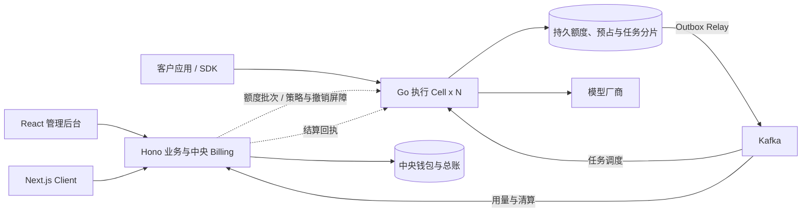

# AI Token SaaS 三系统架构设计方案

更新日期：2026-11-01。

平台为企业与普通用户提供多租户 AI 模型调用服务，采用管理业务系统、LLM Gateway、Client 三个逻辑系统，覆盖文本非流式/SSE、图片异步和视频异步任务。本文在一个文件内完整规定模块、数据归属、资金事务、接口、部署、验收与开发顺序。

核心资金链路为中央批次授权、Go 持久额度子账本地准入、可靠用量事件、Billing 精确清算、原分片应用结算回执。正确扣费是准入底线，100,000 并发按真实工作负载联合验收。

## 1. 产品目标与容量口径

### 目标与容量口径

| 场景 | 验收规模 | 口径 |
| --- | --- | --- |
| 文本流式边界 | 100,000 条活跃 SSE | 真实转发内容与计量，不以空闲连接代替有效流 |
| 媒体任务边界 | 100,000 个异步在途任务 | 包含 QUEUED、DISPATCHING、SUBMITTED、RUNNING、SUBMISSION_UNKNOWN，分别统计 |
| 混合负载 | 文本流与媒体在途任务合计 100,000 | 固定文本/图片/视频比例、时长、输出大小与单企业占比 |

三组是独立验收场景，不等于同时承诺 20 万任务，也不等于 10 万 QPS。稳态同类工作负载可用 并发量 ≈ 到达率 × 平均在途时长 校验测试模型；排队时间与模型运行时间分别记录。持续新请求 QPS、最大单企业 QPS、流时长、媒体大小和上游采购并发需在压测配置中固定。

平台受理能力、厂商执行配额和实际生成算力分别核算。文本请求超过允许的等待和上游容量时明确拒绝；媒体任务按持久队列、公平调度和截止时间受理。

## 2. 产品对象与功能范围

### 产品对象与术语

| 对象 | 含义 |
| --- | --- |
| 平台 API Key | 平台签发给客户应用的调用凭证，绑定租户、应用和策略 |
| 上游凭证 | 模型厂商 API Key 或云身份凭证，由安全存储托管 |
| Token 用量 | 模型计量指标，需区分输入、输出、缓存与厂商特有分类 |
| 租户 | 资源、授权、资金和账单的归属主体，分 personal 与 organization |
| 计费账户 | 租户某一币种的钱包；规范表名 billing_accounts |
| 预算 | 对已有资金的消费约束；设置预算不会新增资金 |

### 功能范围与优先级

P0 表示对外收费上线前需要形成完整闭环；P1 为企业采购与规模化增强；P2 为后续效率与产品扩展。阶段表示功能成熟顺序，不能据此推断工期。

| 功能 | 实现能力 | 优先级 |
| --- | --- | --- |
| 租户与账户 | 个人/企业开户、成员邀请、启停、联系人和账单信息 | P0 |
| 成员权限 | Owner、Admin、Developer、Billing、Auditor；项目范围授权 | P0 |
| 应用与 Key | 服务账号、创建、一次展示明文、撤销、轮换、到期与模型授权 | P0 |
| 模型与上游 | 模型目录、能力、价格、渠道、凭证引用与健康状态 | P0 |
| 调用网关 | 文本非流式/SSE、鉴权、限流、超时、取消和规范错误 | P0 |
| 图片与视频任务 | 持久受理、排队、公平调度、厂商提交、回调/轮询、取消核对、结果文件与费用 | P0 |
| 并发与故障容量 | 文本边界十万、媒体在途边界十万、合计十万混合负载，资金故障联合验收 | P0 |
| 资金准入 | 中央批次授权、完整硬预算、本地额度子账/预占/启动、安全回收与幂等清算 | P0 |
| 计量定价 | 输入、输出、缓存等分项计价，协议价与冻结价格版本 | P0 |
| 账务支付 | 充值、到账、消费、退款、冲正、账单与对账 | P0 |
| 路由容错 | 同模型多渠道、受控重试、授权渠道内切换和熔断 | P0 |
| 日志分析 | 按租户/项目/Key/模型分析请求、用量、费用与故障 | P0 |
| 安全审计 | 数据归属检查、凭证保护、内容开关、管理与资金操作审计 | P0 |
| 运营运维 | 客户支持、成本毛利、异常告警、备份恢复、发布回滚 | P0 |
| 企业身份 | SSO、SAML/OIDC、SCIM、审批、自定义角色 | P1 |
| 企业商业能力 | 合同、套餐、自动充值、授信后付费、专属渠道、BYOK | P1 |
| 产品优化 | 缓存、成本/延迟路由、额外模态、Agent/MCP、跨区域 | P2 |

首批客户若将 SSO、专属部署、区域限制等列为采购前提，对应能力提前进入首发。

### 资金与计费模型

采用租户预充值、实际用量扣费与企业协议价。平台配置一种结算币种和一个支付渠道，保留上游原币成本及适用价格/汇率快照。具体币种与渠道在上线配置中确定。

客户费用、上游采购成本和平台承担的失败成本分别保存。输入、输出、缓存、推理和多模态计量项按厂商语义解释，避免把属于输入或输出子集的计量重复相加。

每个逻辑文本调用或媒体任务采用一次费用上界预占、一次原始最终结算；中央额度授权按批分配，Go 持久化请求级预占，最终收费统一由 Billing 计算。无法形成可靠费用上界的调用形态，需要先明确风险承担和授权机制，再承诺严格预算。

## 3. 技术栈与工程配套

### 核心技术与运行职责

| 部分 | 选型 | 责任 |
| --- | --- | --- |
| 管理后台 | React + TypeScript + Vite | 租户、渠道、价格、订单、异常授权、财务与运营页面 |
| Client | Next.js App Router + TypeScript | 官网、模型与价格、个人/企业门户、文本 Playground、图片视频任务与结果 |
| 业务后端 | TypeScript + Hono，Node.js LTS | 身份、策略、定价、中央钱包、额度分配、支付、清算与总账 |
| Gateway 数据平面 | Go + net/http + chi | 鉴权投影、持久额度执行、文本流、任务引擎、适配器与恢复 |

Gateway 不管理用户注册、成员与角色编辑。中央 Billing 拥有正式资金账；Go 拥有被中央资金担保的额度子账及请求预占，不能直接写中央钱包。最终收费算法统一在 Billing，Go 执行发布的上界规则和资金约束。

### 前端配套

| 领域 | 管理后台 | Client |
| --- | --- | --- |
| 页面与路由 | React/Vite + TanStack Router | Next.js App Router，不叠加 TanStack Router |
| 请求与缓存 | TanStack Query | 服务端按请求读取与客户端 TanStack Query 按页面组合 |
| 组件与样式 | Ant Design，表单优先 Ant Design Form | shadcn/ui + Tailwind CSS |
| 身份 | 独立平台会话与资源权限 | 用户会话、企业切换与服务端成员校验 |
| 发布 | 静态资源与路由回退 | 独立 Next.js Node.js 服务，支持按页面渲染 |

公开官网、说明和模型页可预生成或受控缓存。余额、预算、任务、企业成员和账单按用户及租户读取，不进入跨租户共享缓存。Next.js 的页面代理或 Server Actions 通过 Hono API 执行业务，不获得业务数据库写入权限。[服务端/客户端组件](https://nextjs.org/docs/app/getting-started/server-and-client-components)、[Next.js 部署](https://nextjs.org/docs/app/getting-started/deploying)

任务页面分别显示执行、文件与账务状态，余额展示中央可再分配、子池可用、请求冻结和待入账等有水位的投影。文本流直接访问 Gateway；浏览器使用短期受限授权，生产应用在服务端保存长期 Key。

### Hono 业务工程

业务工程模块化组织 Identity、Tenancy、Access、Catalog、Pricing、Quota Allocation、Billing、Payments、Usage 与 Operations。HTTP 层校验输入、提取身份与映射结果；领域模块与 Hono 请求对象解耦，HTTP 和 Worker 共用同一资金实现。

| 领域 | 配套技术与边界 |
| --- | --- |
| 运行时 | Node.js LTS + Hono Node Adapter；API、分配、清算、支付与报表独立配置资源 |
| 校验与契约 | Zod + @hono/zod-openapi，生成并检查业务与内部 OpenAPI |
| 数据访问 | Drizzle + node-postgres，资金事务使用显式 SQL 与固定锁顺序 |
| 迁移 | Drizzle Kit 生成可审阅 SQL；复杂约束与锁语义显式实现 |
| 认证 | [Better Auth 接入 Hono](https://better-auth.com/docs/integrations/hono)，统一会话认证；平台领域维护用户/租户/角色，管理员与用户会话隔离 |
| 清算 | 消费 Kafka 结算意图，在 Billing 中计算 C、原子入账并生成回执 Outbox |
| 工作区 | Bun workspaces 管理 TypeScript 工程与依赖；生产目标运行时仍为 Node.js |

Hono 的 [Node.js 运行方式](https://hono.dev/docs/getting-started/nodejs)、[Zod OpenAPI 集成](https://hono.dev/examples/zod-openapi) 和 [Drizzle 事务](https://orm.drizzle.team/docs/transactions) 提供框架能力；多级预算、来源、幂等、上界与金额平衡由领域与数据库约束落实。

Billing 仍处理每笔最终收费明细，但可按账户做有界小批清算、合并余额更新，逐请求保留结算与分录。异步化减少首 Token 路径依赖，不消除最终明细写入量。

### Go Gateway 工程

| 模块 | 配套技术与约束 |
| --- | --- |
| HTTP 与流式 | net/http + chi，连接复用、请求取消、有界缓冲、流空闲/总截止时间与优雅排空 |
| 额度执行 | pgx + sqlc，在持久分片内更新子池/预占/切片，确认提交后启动外部执行 |
| 媒体任务 | 有界 Worker、公平调度、持久领取、回调 Inbox 与 next_poll_at 查询恢复 |
| 厂商适配 | 协议、模型能力、提交/查询/取消与计量映射分离；未知提交不盲目重发 |
| 数据访问 | pgx + sqlc，按授权与固定业务键查询，数据库锁保护资金子账 |
| 迁移 | goose SQL 迁移，由 Gateway 维护所有运行时分片的同版本模板 |
| 消息 | Outbox Relay 与 Kafka 兼容客户端，消费者 Inbox 与域级唯一键共同去重 |
| 日志与指标 | 关联 request/task/grant/reservation/attempt/settlement/shard，元数据与内容日志分开 |

[sqlc 支持 pgx](https://docs.sqlc.dev/en/latest/guides/using-go-and-pgx.html)。Go module 独立管理依赖，不跨服务导入可写中央钱包的数据访问包。额度执行统一为 internal/quota 进程内模块，Gateway、媒体与恢复 Worker 复用；私有运行时适配器调用同一实现，正常准入无需网络跳转。

SSE 正文不经过 Kafka 或每 Token 账务 RPC。媒体任务在资金与任务事务确认后返回 202，不为每个待完成视频保留长连接或忙轮询协程。任务、文件保存与清算有独立状态。

## 4. 三系统边界与执行 Cell

### 系统边界与执行 Cell

| 系统 | 运行单元 | 核心责任 | 权威存储 |
| --- | --- | --- | --- |
| 管理业务系统 | 平台管理端、Hono API、分配与清算/支付 Worker | 身份、策略、价格、钱包、授权额度、预算、支付、原始结算与总账 | business_db 高可用部署 |
| LLM Gateway | Go API、额度执行、文本适配、媒体调度/回调/恢复、Relay | 本地持久准入、执行权、三类任务、可靠用量与回执应用 | runtime_db_<cell> 分片 |
| Client | Next.js 公开页与登录门户 | 客户自助业务、Playground、媒体任务与财务展示 | 通过 Hono/Gateway API，不直接写库 |

三系统是逻辑职责，不是固定三个进程。Go 执行 Cell 包含独立容量和持久状态，支持水平扩容；中央分配/清算从管理业务工程独立配置资源。额度执行仍属于 Gateway，正式账本仍属于 Billing。



客户生产推理直接访问 Gateway。正常命中已授权子池的请求不逐笔调用 Hono；首次加载、额度补充、屏障与异步清算通过明确内部契约交互。管理端与 Client 使用不同会话受众，服务端执行资源授权。

## 5. 身份、租户与资源权限

### 租户身份与资源模型

采用统一身份模型：User 表示自然人账户，Tenant 表示资源和资金归属主体，Membership 表示用户在某个租户的角色。Tenant 类型包括 personal 与 organization。一个 User 可以拥有个人租户并加入多个企业租户。

```text
Tenant
├── Wallet / Price Contract / Policies
├── Memberships → Users / Roles
└── Projects
    └── Applications / Service Accounts
        └── API Keys
```

Key 固定归属一个租户、项目和应用；生产应用优先使用服务账号。成员离职撤销其管理权限和个人凭证，企业服务账号的生命周期由企业管理员管理。

| 角色 | 允许的主要操作 | 资源范围 |
| --- | --- | --- |
| 平台运营管理员 | 租户启停、模型渠道、公开价格、运营配置 | 获授权的平台资源 |
| 平台财务 | 到账对账、退款、账务调整与成本报表 | 账务数据与必要客户资料 |
| 租户 Owner | 企业所有权、成员、支付和全租户策略 | 当前租户 |
| 租户 Admin | 项目、应用、Key、预算与成员管理 | 获授权租户或项目 |
| Developer | 调用接入、项目 Key、用量排查 | 获授权项目 |
| Billing | 充值、账单、消费报表 | 当前租户的财务资源 |
| Auditor | 只读审计与合规导出 | 明确授权的数据范围 |

费用查看、内容日志查看、凭证管理、价格修改与账务调整分别授权。平台支持人员临时访问客户敏感数据时，需要记录授权人、原因、范围与有效期。

每次 Client 切换租户后，服务端重新校验 Membership。请求路径中的 tenant_id 仅表示目标资源；授权依据是已认证用户、当前成员关系和资源归属。Gateway 从平台 Key 解析资源归属，不采用客户自报的 tenant_id 或 metadata 作为资金归属。

## 6. 管理业务系统功能模块

### 管理业务系统模块

| 模块 | 责任与输出 |
| --- | --- |
| Identity / Tenancy | 用户、个人/企业租户、成员、项目、应用、服务账号、会话和角色 |
| Access / Policy | Key 生命周期、模型/渠道范围、版本化限制、服务许可与撤销确认屏障 |
| Catalog / Pricing | 模型能力、供应商与凭证引用、销售/采购价格、上界规则、最终计价与合同 |
| Quota Allocation | 当前状态、钱包、来源、全部硬预算的批次授权与安全回收 |
| Billing | 原始结算、最终客户费用、中央余额、平衡总账、消费退款与对账 |
| Payments | 订单、支付尝试/到账、来源与原路退款，外部结果核实 |
| Usage / Operations | 带水位的查询投影、账单、通知、审计、差异处理与运营 |

中央账户、来源、预算分配、结算和总账通过 Billing 统一事务接口维护。Go 请求预占位于自己的运行时事务域，依靠中央已经占用的授权守住资金上限；两库不假装共享事务。

最终收费算法统一在 Billing，Gateway 只执行发布的计价上界及额度约束。中央停止新授权不阻止合法历史结算。分配、清算、门户与报表分别设置连接池、并发及观测，避免管理工作阻塞资金服务。

## 7. LLM Gateway 功能模块

### Gateway 数据平面模块

| 模块 | 处理规则 |
| --- | --- |
| 协议与请求校验 | 文本非流式/SSE、平台图片/视频任务 API，能力/参数/大小/输出上限明确 |
| 本地鉴权 | 必要身份投影、有效服务许可、policy_epoch 与租户资源范围 |
| 分片路由与幂等 | 固定虚拟分片、原请求/任务归属、分片再均衡，不能随机换 Cell 重做收费意图 |
| 额度执行 | 激活 quota_pools，在本地事务预占/启动/未执行释放，应用清算回执与封存回收 |
| 流控与公平性 | 租户/项目/Key、模型、供应商的速率和并发分层保护，不能用速率限流代替资金约束 |
| 路由与适配 | 在授权渠道内选择，维护健康、熔断、请求/响应/错误与用量映射 |
| 文本执行 | 直接流式转发、有界缓冲、超时取消、发送资格与未知恢复 |
| 媒体任务 | 持久受理、公平调度、厂商提交、回调/轮询、取消核对与文件保存状态 |
| 事实与派发 | 原始/标准用量、厂商尝试、Outbox、清算意图与 Inbox 回执 |
| 恢复与观测 | 悬挂资金、未知提交、重复乱序事件、Cell 负载、准入与清算延迟 |

额度执行统一封装为 Go 的 internal/quota 领域模块，Gateway API、媒体与恢复 Worker 复用同一实现，并直接在所属运行时分片内完成事务。请求准入通过进程内函数调用，不增加独立额度 RPC。

每份授权绑定持久分片，不绑定 Pod。多个进程共享同一份持久权威并通过事务协调，不能各维护可独立消费的内存余额。文本与媒体 Worker 分离资源，上游提交结果未知不会自动改回待执行。

## 8. Client 功能与调用上下文

### Client 功能模块与接入方式

| 页面或模块 | 普通用户能力 | 企业附加能力 |
| --- | --- | --- |
| 账户与首页 | 注册登录、余额、用量、快速接入 | 企业切换与企业概览 |
| 模型与价格 | 模型能力、销售价格、示例 | 企业协议价与企业可用模型 |
| 项目与应用 | 个人应用与环境 | 企业项目、服务账号、成员授权 |
| API Key | 创建、复制一次、限制、撤销 | 项目授权、集中管理、批量失效 |
| 预算与用量 | 消费限制、用量明细、告警 | 多级预算、成本归属和项目报表 |
| 媒体任务 | 图片/视频提交、进度、取消、文件与收费状态 | 企业项目归属、预算与任务审计 |
| 钱包与订单 | 充值、支付状态、退款申请 | 企业充值与财务权限 |
| 账单 | 明细、账单下载、发票申请 | 企业抬头、合同、财务导出 |
| 组织与~~安全~~ | 账户安全与个人租户设置 | 成员、角色、邀请、企业策略与审计 |
| 开发者中心 | 文档、示例、错误解释、状态查询 | 企业接入指南与服务账号示例 |

浏览器使用受保护的登录会话调用业务 API，采用安全 Cookie、CSRF 防护和受控跨域策略。平台 Key 的创建明文只在首次成功响应展示，常规列表返回掩码和元数据。

Playground 由业务 API 签发短期、限制模型/额度/用途的调用授权，绑定用户和租户并纳入同一计量链路。客户生产应用使用自己的服务端保管长期 Key；前端静态包与日志不包含厂商凭证。

门户余额分列已入账、中央可再分配、子池可用、请求冻结和待入账，标注更新时间与水位。查询投影不参与资金准入。

### Gateway 所需的上下文

Gateway 无需用户注册、邀请和角色编辑表。示例中的资源、预算与账户由可信 Key 和控制面投影关联，客户自报 tenant_id/metadata 不能决定资金归属。

```json
{
  "tenant_id": "tenant_example",
  "project_id": "project_example",
  "application_id": "app_example",
  "key_id": "key_example",
  "billing_account_id": "account_example",
  "home_shard_id": "shard_example",
  "routing_version": 3,
  "policy_epoch": 12,
  "scope_fingerprint": "scope_example",
  "allowed_models": ["text-example", "image-example", "video-example"],
  "limits": {"rpm": 100, "max_concurrency": 10}
}
```

控制面撤销先为 REVOKING。可服务分片与本地准入有序地持久应用禁用并 ACK，全部确认或得到可验证隔离证据后才 REVOKED。服务许可过期停止新准入；历史已获准入默认完成，紧急取消另留结果和成本证据。

## 9. 数据库与数据归属

### 物理部署与逻辑归属

```text
中央 PostgreSQL 高可用部署
└── business_db
    ├── identity / access / catalog：逻辑领域
    ├── billing：账户、来源、预算、额度分配、结算、总账
    ├── payments：订单、支付与原路退款
    └── operations：变更日志、屏障、路由与可靠事件

执行 Cell 高可用 PostgreSQL 部署 x N
└── runtime_db_<cell>
    ├── runtime_shards / quota_pools：持久分片与授权子账
    ├── request_reservations / reservation_slices：请求级预占
    ├── inference_requests / tasks / provider_attempts：执行
    └── usage_facts / outbox_events / inbox_events / recovery_jobs
```

上述领域名称用于标明数据所有权。生产中央库和运行时库分开部署、角色、连接池、资源与故障策略；每个逻辑分片只有一个可写权威。开发环境复用容器资源，生产使用独立部署。

Redis 负责缓存、流量计数和短期协调，Kafka 负责可靠任务与事件通道，对象存储负责媒体文件，分析存储负责报表投影。它们不替代 PostgreSQL 的资金与幂等权威。

### 标识金额与版本约定

- 所有租户资源携带 tenant_id；项目、应用、Key、任务、资金来源与文件校验一致归属，适用时使用组合外键。
- 内部 ID 使用 UUID；HTTP 中的 req_example 等是示例。跨库引用不假设有数据库外键，通过可信授权、版本、摘要及服务端归属校验约束。
- 金额与单价使用有限精确十进制 NUMERIC(30,12)，接口用字符串；中间计算使用高精度十进制，费用上界 E 向上舍入到存储精度，最终费用 C 按冻结规则在规定阶段舍入。币种、计量单位、最小收费与舍入模式显式定义。数量超过 JavaScript 安全整数范围时也用字符串。
- 时间使用明确时间点，预算窗口使用 UTC；新准入截止、任务截止、服务许可到期和资金关闭是不同概念。
- routing_version 为路由版本，binding_epoch 为额度绑定版本，shard_write_epoch 为分片写入隔离版本，executor_epoch 为尝试领取者版本，policy_epoch 为权限生效版本，不能相互替代。
- 授权绑定持久 home_shard_id，不绑定 Pod。授权与消费事实追加或按显式状态转换更新，不从缓存重新生成余额。

### 中央身份配置与路由

| 表 | 主要字段 | 约束与用途 |
| --- | --- | --- |
| users / tenants | 用户身份引用；租户 type、status | 个人与企业租户统一归属 |
| tenant_memberships / roles / role_permissions | tenant_id、user_id、role、scope、status | 成员关系唯一，平台与租户权限分开 |
| projects / service_accounts / applications | tenant_id、project_id、principal_id、status | 企业服务身份独立于员工账户生命周期 |
| api_keys | id、tenant_id、application_id、prefix、digest、policy_id、status、expires_at | 摘要唯一，明文一次展示 |
| access_policies / access_policy_versions | scope、version、allowed_models、channels、limits | 已发布版本可追踪 |
| models / model_channels | capability_version、计量规则、credential_ref、region、status | 能力与渠道引用有版本 |
| price_versions / tenant_contracts | pricing_items、currency、effective_from/to、rule_version | 已使用版本不可原地覆盖 |
| provider_credential_refs | owner_scope、secret_ref、version | 不保存上游凭证明文 |
| routing_assignments | virtual_shard_id、home_shard_id、cell_id、routing_version、status | 路由切换与分片再均衡受控，不能重试随机换库 |
| gateway_change_log | cursor、entity、version、payload_digest | 持久增量与缺口恢复 |
| policy_revocation_operations / policy_barrier_targets | operation_id、policy_epoch、目标分片、ack、status | REVOKING 到 REVOKED 的确认屏障 |

运行时只保存执行必需投影，不复制 users 或 tenant_memberships。Client 和管理后台通过 Hono API 访问业务状态。

### 中央资金与额度分配表

| 表 | 主要字段 | 关键约束 |
| --- | --- | --- |
| billing_accounts | id、tenant_id、currency、posted_balance、delegated_balance、refund_held_balance、status | UNIQUE(tenant_id,currency)；posted >= delegated + refund_held >= 0 |
| fund_lots | id、account_id、source_type/id、balance、delegated_amount、refund_held_amount、refundable、expires_at | 来源余额 >= 分配占用 + 退款冻结，有限非负 |
| budget_windows | id、rule_id、scope、currency、window_start/end、limit_amount、consumed_amount、delegated_amount、status | UNIQUE(rule_id,window_start)；consumed + delegated <= limit |
| quota_allocation_operations | id、tenant_id、grant_request_id、fingerprint、result | UNIQUE(tenant_id,grant_request_id)，固定原分配结果 |
| quota_grants | id、allocation_operation_id、part_no、account_id、fund_lot_id、home_shard_id、binding_epoch、scope_snapshot、scope_fingerprint、allocated_amount、posted_amount、returned_amount、outstanding_amount、admit_before、status、auth_digest | 一份授权一个来源；UNIQUE(allocation_operation_id,part_no)；L=posted+returned+outstanding |
| grant_budget_allocations | grant_id、budget_window_id、allocated_amount、posted_amount、returned_amount、outstanding_amount | 联合主键；每个适用窗口都占用该授权金额，币种与范围一致 |
| quota_return_operations | return_operation_id、grant_id、binding_epoch、seal_sequence、sealed_amount、seal_digest、status | 回收操作唯一；仅接受原分片已封存金额，不能重复释放 |
| settlements | id、tenant_id、request_id、reservation_id、home_shard_id、operation_id、fingerprint、currency、charged_amount、refunded_amount、usage_ref、pricing_snapshot、status、ledger_transaction_id | 原请求/预占唯一；操作唯一；POSTED 原价与收费不覆盖 |
| settlement_slices | settlement_id、grant_id、slice_order、reserved_amount、charged_amount、binding_epoch | 与原预占切片一致；sum(C_i)=C，每项 C_i<=E_i |
| settlement_receipts | id、settlement_id、receipt_digest、payload | 每份原结算唯一原始回执，同资金事务创建 |
| ledger_accounts / ledger_transactions / ledger_entries | 科目、业务类型/ID、币种、方向、金额与关联事务 | 追加式；业务键唯一，同币种借贷平衡 |
| billing_adjustments | original_settlement_id、operation_id、amount、reason、ledger_ref、status | 消费退款/更正累计受限，原收费不可变 |

上述余额、占用、预算和授权金额字段分别约束为非空、有限、非负；不只检查若干金额相加非负。scope_snapshot 保存完整资源与预算范围，摘要用于验证内容，不能用不可还原的哈希代替授权依据。

一个分配操作可从多个来源生成多份 quota_grants，所有授权的总额才是本次分配金额。中央账户和各预算按总额占用，各来源按各自份额占用，不重复按总额累计到每份授权。

每份授权携带完整硬预算集合与可准入范围。request_reservations 不在 business_db；中央 settlements 保存其不可变结算依据副本，跨库关联以稳定 ID 和摘要验证。

### 运行时额度与请求表

| 表 | 主要字段 | 关键约束与恢复规则 |
| --- | --- | --- |
| runtime_shards | home_shard_id、routing_version、shard_write_epoch、status | 资金和执行写入都验证当前可写版本；分片再均衡先封存原写入权威 |
| quota_pools | grant_id、binding_epoch、tenant_id、scope_snapshot、scope_fingerprint、fund_lot_ref、allocated_amount、free_amount、held_amount、confirmed_charged_amount、sealed_return_amount、admit_before、status、source_digest | grant_id 唯一；L=F+H+X+R；重复激活不重置金额 |
| request_reservations | id、tenant_id、request_id、authorized_amount、held_amount、captured_amount、released_amount、currency、pricing_snapshot、policy_epoch、scope_fingerprint、status、settlement_operation_id、settlement_id | UNIQUE(tenant_id,request_id)；E=held+captured+released；一次原始结算 |
| reservation_slices | reservation_id、grant_id、slice_order、reserved_amount、held_amount、captured_amount、released_amount、binding_epoch | 固定切片顺序与归属；请求与子池变更同事务 |
| inference_requests | id、tenant_id、application_id、key_id、home_shard_id、reservation_id、operation_kind、fingerprint、execution_status、billing_status | 根逻辑调用，执行与账务状态独立 |
| idempotency_records | tenant_id、application_id、operation_kind、key_digest、fingerprint、request_id、task_id、home_shard_id、result_ref | 作用域组合唯一；相同意图固定原归属，不按内容哈希合并合法调用 |
| tasks | id、request_id、kind、status、queue_deadline、provider_job_id、next_poll_at、result_storage_status、result_ref、cancel_status | 图片/视频异步任务，受理与预占/Outbox 同事务 |
| provider_attempts | id、request_id、attempt_no、channel_id、provider_account_id、provider_request_id、provider_job_id、executor_epoch、status、dispatch_fingerprint | UNIQUE(request_id,attempt_no)；DISPATCHING/UNKNOWN 不因任务租约过期重新提交 |
| usage_facts | id、request_id、attempt_id、version、schema_version、provider_usage、normalized_usage、usage_status、content_digest | 原始与标准计量保留来源，事实变更追加版本 |
| policy_projections / serving_permits | scope、policy_epoch、status、valid_until、source_digest | 与准入有序生效，许可不足或过期停止新准入 |
| revocation_barrier_acks | operation_id、home_shard_id、policy_epoch、applied_sequence | 与本地禁用状态有序提交，完成持久确认后 ACK |
| outbox_events / inbox_events | event_id、type、aggregate/version、payload_digest、状态、游标 | 接收去重和领域写同事务，领域唯一键再防不同事件 ID 的重复副作用 |
| grant_return_seals | return_operation_id、grant_id、seal_sequence、amount、digest、status | 先本地封存 F 转 R，再请求中央回收；关闭墓碑不随缓存 TTL 删除 |
| recovery_jobs | subject_id、kind、status、lease、attempt_count、next_retry_at、last_error | 有限重试、未知结果恢复和人工核对 |

配额字段含义为：L 原始授权，F 可新预占，H 当前请求冻结，X 已应用回执的累计消费，R 已封存归还额（含待确认）。同一数据库事务维护池、预占与切片，不能让两个进程各自维护可独立消费的内存 F。

任务执行使用 QUEUED、DISPATCHING、SUBMITTED、RUNNING、SUCCEEDED、FAILED、CANCELED、SUBMISSION_UNKNOWN；文本使用 ACCEPTED、DISPATCHING、STREAMING、COMPLETED、FAILED、CANCELED、UNKNOWN。请求账务状态统一使用 RESERVED、RECONCILING、SETTLEMENT_PENDING、POSTED、RELEASED。

### 支付与退款

| 表 | 主要字段与约束 |
| --- | --- |
| topup_orders | tenant/account、amount、currency、status；商业入账意图唯一 |
| payment_attempts | order_id、provider_account_id、merchant_reference、status；未知结果显式 UNKNOWN |
| payment_transactions | provider_account_id + provider_transaction_id 唯一，保留所有真实到账事实 |
| payment_refunds | original_payment_id、operation_id、amount、currency、status、provider_ref、fingerprint；原路退款独立操作 |
| refund_holds | refund_id、account_id、fund_lot_id、amount、status；只冻结中央未分配、可退来源 |

已分配资金必须先安全回收才可参与充值款退款。消费退款增加中央来源与余额，不回写旧子池 X；是否回补原预算窗口由冻结退款规则控制。

### 余额与事件水位

posted_balance 是正式已入账余额，delegated_balance 是所有授权 outstanding_amount 的合计，refund_held_balance 是有效退款冻结。中央可再分配值不是客户全部可继续调用额度：分片 F 仍是客户可用但已委托的资金。

门户分列中央可再分配、子池可用、请求冻结、待入账与退款冻结，并返回 as_of/watermark。查询投影不作为准入依据。中央已记账但本地未应用回执时，outstanding 与 F+H 暂不相等；先核对在途回执和回收，再判断差异，静止收敛后才直接比较。

### 索引保留与隔离

| 访问路径 | 索引或约束 |
| --- | --- |
| 账户与币种 | UNIQUE(tenant_id,currency) |
| 授权申请重试 | UNIQUE(tenant_id,grant_request_id) |
| 有效额度选择 | home_shard_id、scope_fingerprint、status、admit_before，按稳定 grant_id 排序锁定 |
| 原预占与原结算 | tenant_id/request_id 与 reservation_id 业务唯一键 |
| 公共幂等 | tenant_id、application_id、operation_kind、key_digest 唯一 |
| 待调度/待轮询 | status、next_poll_at、queue_deadline，使用有界领取与固定排序 |
| 厂商任务映射 | provider_account_id、provider_job_id 唯一（适配器范围内） |
| Outbox/Inbox | 可投递状态、next_retry_at、event_id；按领域业务键额外去重 |
| 租户调用与流水 | tenant_id、时间、稳定 ID 游标索引 |

按 Cell 和查询负载做物理分片，按时间做适当分区。未清算事实、有效 H、未确认 R、幂等墓碑和关闭授权不得随内容日志 TTL 清除；归档前验证结算闭合和可追踪性。

行级安全可作为纵深隔离，运行角色、表所有者与 BYPASSRLS 的行为需明确，连接池租户上下文使用事务范围设置。[PostgreSQL 行级安全](https://www.postgresql.org/docs/current/ddl-rowsecurity.html)

详细事务、状态和金额守恒见 [账务设计](04-billing-and-ledger.md)，跨系统调用与事件见 [接口契约](05-api-contracts.md)。

## 10. 资金、预占与清算事务

### 权威与金额定义

| 对象 | 权威与更新入口 |
| --- | --- |
| 中央钱包、资金来源、预算分配、原始结算与总账 | Hono 工程的 Billing 模块，HTTP 和清算 Worker 复用同一实现 |
| 额度子池、请求预占、执行权与原始用量事实 | Go 执行分片，以本地持久事务更新 |
| 最终客户收费 C | Billing 根据准入冻结规则和可靠事实计算，Go 和前端不另写一套最终收费算法 |
| 客户采购成本与客户收费差异 | 每次上游尝试记录采购事实；平台重试、失败和超上界差异分别核算 |

所有金额有限、非负并显式带币种；方向用业务类型或分录表达。金额和单价使用精确十进制 NUMERIC(30,12)，JSON 使用字符串；禁止 JavaScript number 或 Go 浮点参与资金计算。中间计算使用高精度十进制，上界 E 向上舍入到存储精度，最终 C 按冻结规则在规定阶段舍入，禁止逐 Token 舍入。数量带单位，单位换算、最小扣费与舍入模式固定到规则版本。[PostgreSQL 数值类型](https://www.postgresql.org/docs/current/datatype-numeric.html)

冻结 pricing_snapshot 包含模型/能力版本、销售价格、计量分类、舍入规则、上界算法版本、输出/数量/时长上限、允许渠道范围和客户收费结果规则。输入、缓存、推理 Token 的子集语义不得重复相加。上界 E 按可验证的保守规则计算，最终 C 按可信用量计算，正常支持的计价形态要求 0 <= C <= E。

发现计算费用超 E 时保留 RECONCILING，记录原始用量、采购成本与差额，禁止无新授权超扣或覆盖原授权。无法形成可靠上界的形态需先有明确授权机制；缺失计量按公开裁决规则处理，不静默把估算当精确收费。

### 中央账户与预算不变量

```text
P = billing_accounts.posted_balance
D = billing_accounts.delegated_balance
H_refund = billing_accounts.refund_held_balance
中央可再分配金额 U = P - D - H_refund
P >= D + H_refund；P、D、H_refund 均有限且非负
D = sum(该账户全部 quota_grants.outstanding_amount)

预算：consumed_amount + delegated_amount <= limit_amount
delegated_amount = sum(关联授权在该窗口的 outstanding_amount)
资金来源：balance >= delegated_amount + refund_held_amount
```

中央 D 已覆盖子池未用额度、在途请求和待清算金额。不能再把所有运行时 held_amount 从 P 中重复扣除。资金来源余额和占用合计与对应账户投影一致。

预算 consumed_amount 是按规则回补后的净预算消费；原始授权 posted_amount 和原始收费保持不变。退款预算回补通过关联原窗口的调整记录表达。调低限额不得小于已消费与未结清分配之和，可先阻止新准入并回收未用额度；新增硬预算或变更范围须发布新 policy_epoch/scope，旧子池不能继续为新范围准入。

### 授权与子池不变量

```text
中央一份授权：L = C_posted + R_posted + O
L = allocated_amount；O = outstanding_amount
C_posted = posted_amount；R_posted = returned_amount

本地一份子池：L = F + H + X + R
F = free_amount；H = held_amount
X = confirmed_charged_amount
R = sealed_return_amount（含等待中央确认的封存归还）

请求：E = held_amount + captured_amount + released_amount
切片：sum(E_i) = E；每片 E_i = held_i + captured_i + released_i
```

每个金额分量均非负。X 只随中央消费回执增加，消费退款不修改它。R 封存后不能重新加入 F，回收确认丢失也不能本地撤回。相同 grant_id 的重放不能再次初始化额度。零费请求可使用 E=0 且无金额切片，但仍需有效身份/服务许可和零元结算记录，任何非零收费须有有效授权。

授权绑定一个资金来源和完整预算窗口集合。一个分配操作可生成多份授权；一个请求可用多个同分片、同租户、同币种且作用域完全匹配的授权切片。以冻结的 slice_order 将 C 分配为 C_i，sum(C_i)=C 且每项 0<=C_i<=E_i。

中央清算可能先于本地回执应用：此时 C_posted >= X；封存回收可能先于中央确认：此时 R >= R_posted。按一致水位比较时：

```text
O = F + H - (C_posted - X) + (R - R_posted)
```

原始实时读数未对齐水位时不直接比较。静止收敛后 C_posted=X、R_posted=R、O=F+H。任何差额先追踪在途回执和回收，不将差额补成新资金。

### 分配授权事务

分配接口以 tenant_id + grant_request_id 幂等，原请求指纹包括账户、范围、目标分片和期望总额。重试返回原授权列表。

```text
BEGIN（中央 business_db）
  按固定顺序锁账户、原预算窗口与资金来源
  复核租户/Key/策略、来源资格、币种与可授权范围
  检查分配操作幂等：同意图返回原结果，不同载荷冲突
  检查 U、全部预算空间和全部来源空间足够
  创建 allocation_operation；按来源拆出 quota_grants
  账户 D += 本次授权总额
  每个适用预算 delegated += 本次授权总额
  各来源 delegated += 分配给该来源的金额
  写 grant_budget_allocations、原结果和 quota.granted Outbox
COMMIT 并取得所需同步持久化确认
```

每份授权同一来源、同一作用域，向下发放的预算路径不能遗漏租户/项目/Key 硬限额。领取、激活确认或新准入截止超时都不能自动撤销中央占用。

Go 在本地事务中校验授权来源、摘要、home_shard_id、binding_epoch 与范围，按 grant_id 幂等创建 quota_pools。授权重放只能读取现有结果；内容不同、旧快照或已关闭墓碑冲突时隔离，不能把 F 重置为 L。

### 请求预占与执行权

```text
BEGIN（同一 runtime_db 分片）
  校验当前 shard_write_epoch、有效 serving_permit、policy_epoch
  通过公共幂等作用域确定原 request_id 和 home_shard_id
  检查原请求指纹，校验当前访问身份与资源归属
  锁定完整授权范围匹配的子池，按 grant_id 固定顺序
  校验新准入截止、来源/窗口规则、允许模型/渠道与 F >= 所需份额
  冻结 pricing_snapshot、窗口、上界 E 和授权切片 E_i
  各池 F -= E_i，H += E_i
  创建请求、request_reservations、reservation_slices
  异步任务同时创建 QUEUED task 与 task.ready Outbox
COMMIT 并取得持久化确认
```

文本可在已准备好执行时将预占与取得发送资格合并为一个短事务。异步任务排队后，由 Worker 在本地事务中把任务转为 DISPATCHING、预占转 STARTED，并绑定 attempt_id/executor_epoch。上游 HTTP 在持久化确认后、数据库事务外执行。

新的领取者可以接管明确未发送任务；DISPATCHING、UNKNOWN、SUBMISSION_UNKNOWN 不因 Worker 领取租约过期而自动重发。存储 fencing 约束旧写者的新状态变更，但不能撤回已发送的厂商请求；恢复必须查询或保留未知状态。

### 请求与任务状态

| 对象 | 状态及约束 |
| --- | --- |
| request_reservations.status | HELD、STARTED、RECONCILING、AWAITING_SETTLEMENT、SETTLED、RELEASED |
| HELD | 未取得发送资格；与 start 竞争成功的取消/队列截止可释放 |
| STARTED | 已授予本地发送资格；不得因 TTL、断流或 Pod 消失直接释放 |
| RECONCILING | 提交/执行/用量不明确，继续保留 H |
| AWAITING_SETTLEMENT | 用量与结算意图已持久化，等待中央回执，继续保留 E |
| SETTLED | 已应用正式回执，captured=C、released=E-C、held=0 |
| RELEASED | 确认未发送，captured=0、released=E，旧执行者不能再发送 |
| 请求 billing_status | RESERVED、RECONCILING、SETTLEMENT_PENDING、POSTED、RELEASED，与执行状态独立 |

未发送取消：在本地同一事务确认仍 HELD 且未取得发送资格，任务/请求转取消，H 减 E、F 加 E、切片和预占转 RELEASED，写不可变 no_execution 事实与零收费结算意图。中央零元回执仅确认记录，不再释放一次，billing_status 保持 RELEASED。

已执行但最终按规则零收费：按正常清算出具 C=0 回执，执行过的预占转 SETTLED，billing_status 为 POSTED，全部 E 释放；可以没有收费账本分录，但必须有零元结算记录。

图片/视频从受理到排队、生成、回调和清算都保留约束；取消请求不等于已取消或不收费。文件保存失败不重做生成，执行结果、文件状态与账务状态分别维护。

### 中央清算事务

结算事件提供 request_id/reservation_id、home_shard_id、稳定 settlement_operation_id、用量依据、冻结规则与完整 E_i 切片。Billing 校验历史合法授权，不因当前 Key 已撤销或授权处于 DRAINING 而拒绝合法历史费用。

最终价格只由 Billing 的版本化计价实现计算；用量缺失保留待核对，不提前释放。批处理按账户和固定锁顺序处理有界数量，仍保留每请求原始结算与分录。冲突事件隔离，不能静默跳过或覆盖。

```text
BEGIN（中央 business_db）
  去重事件和原始收费业务键，核验原请求/预占/授权/事实指纹
  锁账户、授权、原预算窗口和资金来源
  按冻结规则计算 C，校验 0 <= C <= E，并分配 C_i
  创建原 settlements、settlement_slices；非零 C 写平衡消费分录
  账户 P -= C，D -= C
  每份授权 posted += C_i，outstanding -= C_i
  每个原预算 consumed += C，delegated -= C
  各原来源 balance -= C_i，delegated -= C_i
  写 settlement_receipts 与 settlement.posted Outbox
  Inbox 去重、业务状态、余额、分录和回执同事务提交
COMMIT 并取得持久化确认
```

一个窗口可能关联多个切片，按该窗口涉及的 C_i 合计更新，不对切片重复按整笔 C 累加。相同 request/reservation 即使换了事件 ID 或操作 ID，也不能产生第二份原结算；同操作不同事实返回冲突并核对。

中央账户 P 与 D 同减 C，因此清算本身不增加中央可再分配 U。剩余 E-C 仍在原子池中可用，只有安全回收才释放中央委托占用。

### 应用结算回执

```text
BEGIN（原 home_shard 的 runtime_db）
  校验中央来源、receipt_id/digest、原预占、E_i/C_i 与历史绑定
  去重 Inbox 和领域 receipt/settlement 业务键
  若已本地确认未执行 RELEASED：只接受 C=0，登记确认，不改池金额
  否则各切片 H -= E_i，X += C_i，F += E_i-C_i
  原预占 held=0、captured=C、released=E-C、status=SETTLED
  更新请求 billing_status=POSTED、settlement_id 和回执水位
COMMIT 并确认
```

重复回执不再释放金额。回执丢失时重投或按原操作查询，未确认前 H 保留。中央已有收费与本地 H 仍未消除属于有证据的中间态，不是再补一次余额的理由。

### 回收与额度关闭

本地 ACTIVE 转 DRAINING 后停止新预占。事务中将可归还 q 从 F 移至 R，生成递增 seal_sequence 和稳定 return_operation_id、封存摘要及 Outbox。此后不能因 HTTP 超时把 q 放回 F。

中央验证历史授权、封存来源与未重复的回收操作，在同一事务中 returned += q、outstanding -= q、账户 D -= q，并释放对应来源与原预算 delegated；写 quota.returned 回执。两边确认后记录回收水位，R 不再减少。

仍在 H 的金额、未核实消耗和未应用回执必须保留。DRAINING 期间回执释放出的 F 可再次封存形成新的回收操作。只有 H=F=0、X+R=L、中央 outstanding=0 且回收/结算全部确认后关闭。新准入截止不是资金关闭时间。

已关闭授权和幂等墓碑须能阻挡晚到授权消息。分片数据丢失或从旧快照恢复时先 QUARANTINED，不能据旧 F 再准入；核对中央授权、消费和在途证据后才恢复，无法核实的原额度继续占用。

### 正式账本与支付

ledger_transactions 使用 UNIQUE(tenant_id,business_type,business_id)，ledger_entries 的金额严格正数且币种与事务一致。每个非零事务至少两条分录、同币种借贷合计相等。已入账记录不修改删除，更正追加反向或调整事务。

跨行平衡由统一记账入口与必要的事务结束约束实现，不能用单行 CHECK 声称保证。[PostgreSQL 约束触发器](https://www.postgresql.org/docs/current/sql-createtrigger.html)

充值使用稳定商户引用：先持久化订单/支付尝试，外部调用在事务外；回调或查询核验签名、商户、交易号、订单、币种和金额。保存支付事实、充值分录、P/来源余额与通知同事务。支付事件 ID、渠道交易号和商业入账意图分别去重；同一订单多笔真实到账全部保留，额外款项进入差异处理。超时或晚到成功不按本地失败覆盖外部事实。

### 三类释放与退款

| 操作 | 资金变化 | 约束 |
| --- | --- | --- |
| 未发送请求释放 | 子池 H 转 F，中央 P/D 不变 | 与发送资格原子竞争；不能对已启动未知任务使用 |
| 消费退款 | 中央 P 与对应来源增加，追加退款分录 | 累计不超原 C，X 和原收费不改；后续经新授权消费 |
| 充值款原路退款 | 先冻结中央未分配且可退款来源，外部成功后 P/来源余额减少 | 先回收已委托未用金额，不动在途 H；外部 UNKNOWN 保持退款冻结 |

消费退款如回补预算，记录原窗口及金额，不把旧消费退到新窗口；不覆盖原始授权 posted_amount。来源过期、赠送额度与手续费分别执行公开规则。支付争议、后付费与负余额风险另建模型，不通过篡改既有预付账消除差异。

### 示例与对账

下表为同一示例币种，一份 L=100 的授权和一笔 E=20、C=12 的请求；U 是中央可再分配金额。

| 阶段 | P | D | U | F | H | X | R |
| --- | ---: | ---: | ---: | ---: | ---: | ---: | ---: |
| 账户有余额 | 1000 | 0 | 1000 | — | — | — | — |
| 分配 100 | 1000 | 100 | 900 | 100 | 0 | 0 | 0 |
| 请求预占 20 | 1000 | 100 | 900 | 80 | 20 | 0 | 0 |
| 中央入账 12，回执在途 | 988 | 88 | 900 | 80 | 20 | 0 | 0 |
| 应用回执 | 988 | 88 | 900 | 88 | 0 | 12 | 0 |
| 本地封存归还 88 | 988 | 88 | 900 | 0 | 0 | 12 | 88 |
| 中央确认回收 | 988 | 0 | 988 | 0 | 0 | 12 | 88 |
| 后续消费退款 2 | 990 | 0 | 990 | 0 | 0 | 12 | 88 |

退款后原收费仍为 12，退款为 2，净收费 10；旧池 X 仍为 12，不能再次消费。门户区分中央可再分配、子池可用、请求冻结和待入账，避免将委托资金显示为已消费。

对账核验：P 与总账净余额一致；D 与中央授权 O 合计一致；每个预算 consumed 与净预算消费一致；来源余额及占用与账户一致；每份子池与切片守恒；回执/回收按同一水位收敛；每笔账本借贷平衡；原收费减退款等于净收费。

### 持久化与故障确认

额度、执行权、记账和回收的成功确认须达到目标同步持久化级别；不能用 Redis 副本或普通异步主从声称资金不丢。故障时只提升包含已确认资金状态的安全副本，无法证明则停止新付费准入。[PostgreSQL/Patroni 复制约束](https://patroni.readthedocs.io/en/latest/replication_modes.html)

COMMIT 结果未知时，普通 SELECT 的可见记录不足以证明已完成复制确认。任何会触发授权派发、上游发送或资金回执的重放，需经新的幂等确认写或经验证的持久化屏障，达到同级确认后再产生外部副作用。Outbox Relay 的派发领取标记也先通过该确认，避免发出尚不安全的授权/回执。

Key/租户冻结停止新授权，并通过分片确认屏障阻止新的本地准入；合法历史结算继续执行。具体接口、回执及错误语义见 [接口契约](05-api-contracts.md)，真实数据库和故障验收见 [可靠性方案](07-reliability-and-validation.md)。

## 11. 文本非流式与 SSE

### 文本流式执行

1. 校验 Key 投影、服务许可、模型、参数、路由约束与流量限制，从可信上下文解析租户和账户。
2. 解析请求幂等归属，按固定顺序锁本地子池，冻结计价/预算/输出上限，写请求、request_reservations、reservation_slices 与执行意图。
3. 以持久条件转换取得唯一 attempt_id 的发送资格。未发送取消与启动在本地状态上原子竞争；同步持久化确认后才向上游发送。
4. 通过受控连接池直接转发 SSE，分离首 Token、流空闲与总截止时间，限制每流缓冲和慢客户端占用。正文不逐 Token 进入账务 RPC 或 Kafka。
5. 结束或中断时保存原始用量摘要、标准计量、实际交付情况及结算意图 Outbox。无可靠用量进入 RECONCILING，冻结继续有效。
6. Billing 异步出具结算回执，本地幂等更新子池和请求状态；客户已看到内容不代表总账已经入账。

SSE 断流后不透明拼接另一份生成。节点退出可能中断连接，不能承诺任意模型流无缝续传。执行结果未知时不自动重发；厂商幂等能力需针对具体接口验证。输入、输出、缓存、推理 Token 按厂商语义分类，子集字段不得重复相加。

## 12. 图片与视频异步任务

### 图片与视频异步任务

任务受理事务同时完成请求幂等、费用上界预占、task_id、任务状态和 task.ready Outbox，达到持久化确认后才返回 202。队列暂不可用时依靠 Outbox 恢复；达到积压或存储水位时暂停新增受理。

```text
执行：QUEUED -> DISPATCHING -> SUBMITTED -> RUNNING -> SUCCEEDED / FAILED / CANCELED
提交结果未知：DISPATCHING -> SUBMISSION_UNKNOWN -> 查询恢复 / 人工核对
账务：RESERVED -> SETTLEMENT_PENDING -> POSTED
用量未知：RESERVED -> RECONCILING -> SETTLEMENT_PENDING
确认未执行：RESERVED -> RELEASED
```

QUEUED 期间已占用资金。取消或排队截止与领取发送资格在同一状态记录上竞争，只有确认未发送的一方可释放。DISPATCHING 后提交响应丢失时保存 SUBMISSION_UNKNOWN；不能直接改回 QUEUED 重发。

Worker 以模型、租户、上游配额和任务权重做有界公平调度。图片/视频与 SSE 使用独立资源池；待完成任务通过 next_poll_at 索引、延迟调度和退避查询恢复，不为每个任务维护长连接或忙轮询协程。

接收回调先验签、校验上游账户及 provider_job_id 与本地尝试映射，持久 Inbox 后响应，异步做状态转换。重复事件和不同事件 ID 的同一业务结果均须去重；迟到进度不能回退终态。轮询查询作为回调丢失的补充。[Webhook 重复与乱序说明](https://replicate.com/docs/topics/webhooks/receive-webhook)

图片按照数量、尺寸、质量等已声明计量项，视频按照时长、分辨率、帧率、音轨或模型固定单价等冻结规则计算上界和最终费用。具体计量字段以适配器能力清单为准，不能把不同厂商同名字段直接相加。

取消请求仅表示正在尝试取消。确认已执行的失败/取消也可能有费用，先核实结果与用量，再按客户合同结算；采购成本另记。不同供应商对取消的收费不同，例如 Replicate 区分未开始终止与开始后取消。[任务计费示例](https://replicate.com/docs/topics/predictions/lifecycle)

任务结果状态、文件保存状态和账务状态分别记录。图片/视频通过对象存储直传、引用及下载授权交付；文件搬运失败重试下载或保存，不重新发起生成。已有的在途任务不会因为授权新准入时间结束而被误判为零费用。

## 13. 接口与事件协作

身份、租户、项目和账户从受信会话或平台 Key 解析。门户与管理接口由 Hono 提供，客户推理与媒体任务由 Go Gateway 提供。中央内部入口统一为 /internal/v1，Go 私有控制适配器为 /runtime/v1；正常预占与启动调用进程内 internal/quota 模块。

### 接口边界与认证

| 调用方 | 入口与认证 | 责任 |
| --- | --- | --- |
| 管理后台 | /admin/v1，独立平台会话与权限 | 租户、模型、价格、资金运营、对账和审计 |
| Client | /console/v1，用户会话与当前租户成员关系 | 个人/企业自助业务；Next.js 可代理但不自建钱包 |
| 客户应用 | Gateway /v1 模型协议、/gateway/v1 平台任务接口；平台 Key | 文本、图片与视频调用，归属从 Key 解析 |
| 控制平面与分配/清算 Worker | /internal/v1，服务身份与私网权限 | 授权、回收、计量接收与清算 |
| Cell 内部组件 | Go 领域函数；/runtime/v1 私有适配器校验服务身份与分片权限 | 持久化激活、预占、启动、释放与回执应用 |
| 模型厂商 | /callbacks/v1/providers/{provider}/tasks，厂商验签 | 保存可信回调，状态恢复；不直接记账 |

### 门户与管理接口

| 接口 | 行为 |
| --- | --- |
| POST /console/v1/sessions | 建立会话，认证组件原生路径由接入层统一映射 |
| GET /console/v1/me/tenants | 当前可访问租户 |
| GET/POST /console/v1/tenants/{tenant}/projects | 项目列表与创建 |
| GET/POST /console/v1/tenants/{tenant}/api-keys | Key 元数据、创建与一次明文展示 |
| POST /console/v1/tenants/{tenant}/api-keys/{key}:revoke | 创建撤销操作，返回 operation_id 与 REVOKING/REVOKED |
| GET /console/v1/operations/{operation_id} | 查询撤销、回收等异步操作进度及未确认目标 |
| GET /console/v1/tenants/{tenant}/models | 可用模型、能力与适用价格版本 |
| GET/PUT /console/v1/tenants/{tenant}/budgets/{budget} | 查询/修改预算，约束已消费与未结清分配额 |
| GET /console/v1/tenants/{tenant}/wallet | 分列 posted、中央可再分配、子池可用、请求冻结、待入账与退款冻结，携带 as_of/watermark |
| POST /console/v1/tenants/{tenant}/topup-orders | 创建充值意图，由服务端确定金额与币种 |
| GET /console/v1/tenants/{tenant}/orders/{order} | 核实后的订单状态 |
| GET /console/v1/tenants/{tenant}/usage | 消费与执行查询投影，区分待核对、待入账与已入账 |
| GET /console/v1/tenants/{tenant}/tasks/{task_id} | 服务端鉴权后路由原分片查询；不跨库写任务 |
| GET /console/v1/tenants/{tenant}/invoices | 已出账单与更正记录 |
| POST /console/v1/tenants/{tenant}/playground-authorizations | 签发短期、受限用途/模型/额度的调用授权 |

### 模型与异步任务 API

| 接口 | 成功语义 |
| --- | --- |
| GET /v1/models | 当前 Key 可调用模型 |
| POST /v1/chat/completions | 文本非流式或 SSE，遵循声明的协议语义 |
| POST /v1/responses | 按明确的兼容范围实现与验证，不假设与其他协议相同 |
| GET /gateway/v1/requests/{request_id} | 逻辑请求执行与账务状态，包含原 home_shard_id |
| POST /gateway/v1/tasks | 图片/视频任务；预占、幂等、任务与 Outbox 持久确认后返回 202 |
| GET /gateway/v1/tasks/{task_id} | 状态、结果引用、账务状态和重试建议，不重新提交生成 |
| POST /gateway/v1/tasks/{task_id}:cancel | 未发送可原子取消；否则返回取消受理状态，后续查询结果 |

### 中央内部 API

| 接口 | 行为与幂等 |
| --- | --- |
| GET /internal/v1/gateway/snapshots | 受限配置、价格规则、策略、路由和服务许可快照 |
| GET /internal/v1/gateway/changes?cursor=... | 持久游标增量，缺口触发快照核对 |
| POST /internal/v1/quota-grants | 以 grant_request_id 分配一批额度，不是每请求预占 |
| GET /internal/v1/quota-allocations/by-operation/{grant_request_id} | 描述原分配操作状态；普通读不单独授予执行权 |
| POST /internal/v1/quota-allocations/{operation_id}:confirm | 结果未知时通过同级持久化确认取得原授权，不重新分配 |
| POST /internal/v1/quota-grants/{grant_id}:return | 接受原分片封存证明与 return_operation_id，幂等回收 |
| POST /internal/v1/settlements:batch | 异步有界小批清算，每个 settlement_operation_id 独立幂等 |
| GET /internal/v1/settlements/by-operation/{operation_id} | 查询原结算；可执行回执须来自持久确认流程 |
| POST /internal/v1/settlements/{settlement_id}:confirm | 对结果未知的结算执行同级确认并返回原回执 |
| POST /internal/v1/usage-events:batch | 幂等接收用量与采购尝试事实，不等于直接扣款 |
| POST /internal/v1/policy-barriers/{operation_id}:ack | 校验目标分片与持久水位，推进撤销操作 |

### Cell 内部运行时契约

| 私有入口；进程内调用复用同一领域方法 | 行为 |
| --- | --- |
| POST /runtime/v1/grants:activate | 校验 grant 身份、摘要、绑定和墓碑，幂等激活子池 |
| POST /runtime/v1/admissions | 校验服务许可/策略与幂等，在同一分片持久预占、请求、切片及可选异步任务 |
| POST /runtime/v1/admissions:resolve | 原提交结果未知时确认原操作，不能创建新请求 |
| POST /runtime/v1/reservations/{id}:start | 与取消竞争，持久取得尝试发送资格；重复读取原许可不允许再次发送 |
| POST /runtime/v1/reservations/{id}:release | 仅 HELD 且确认未取得发送资格时 H 转 F |
| POST /runtime/v1/grants/{id}:seal-return | 先停新准入、F 转封存 R、生成回收 Outbox |
| POST /runtime/v1/settlement-receipts | 去重回执、H/X/F 与请求状态同事务更新 |
| POST /runtime/v1/policy-barriers/{operation_id}:apply | 与准入有序应用禁用 epoch，持久确认后生成 ACK |

### 消息类型与消费确认

| 事件 | 发送方到接收方 | 确认含义 |
| --- | --- | --- |
| quota.granted | Billing 到原执行分片 | 中央已占用资金；本地激活仍须持久去重 |
| task.ready | Runtime 到媒体调度 | 任务可被检查领取，不证明已执行 |
| task.state_changed / usage.observed | Runtime 到查询/计量消费者 | 状态或用量事实，非最终扣款 |
| settlement.requested | Runtime 到 Billing | 请求按冻结规则清算，不提供最终金额权威 |
| settlement.posted | Billing 到原 Runtime | 原始结算已正式入账，可幂等应用回执 |
| quota.return_sealed / quota.returned | Runtime 到 Billing，再到 Runtime | 已封存归还意图、中央回收结果，不能相互替代 |
| policy.barrier_requested / policy.barrier_applied | 控制面到分片，再回控制面 | 禁用投影与准入有序落地的证据 |
| payment.posted | 支付模块到投影消费者 | 经核验支付已入账 |

### 撤销与错误语义

| 状态与错误 | 调用方行为 |
| --- | --- |
| 401 invalid_credential | 更新无效/过期凭证 |
| 403 forbidden / model_not_allowed | 调整授权，不自动换未授权资源 |
| 402 insufficient_funds | 仅在可用授权及中央可分配/安全回收路径确认不足后返回 |
| 429 rate_limit_exceeded / budget_limit_exceeded | 区分流量与已确认硬预算不足，按 Retry-After 或配置处理 |
| 409 idempotency_conflict / settlement_conflict | 保留原意图和证据，禁止换新标识绕过 |
| 503 quota_refill_pending / funds_temporarily_unavailable | 额度补充或回收暂不可确认，不误报余额为零 |
| 503 home_shard_unavailable / durability_unconfirmed | 使用原标识查询或等待恢复，不重新发起资金操作 |
| RECONCILING / SUBMISSION_UNKNOWN / CANCEL_REQUESTED | 可查询中间态，不等同失败或已退款 |

### 回调取消与未知结果

回调持久化前验证厂商签名、上游账户、provider_job_id 或已保存 client_reference 与本地尝试映射。暂未关联的可信回调进入待关联 Inbox，不能按回调自报租户写账。持久接收后再应答，重投按事件及业务终态去重。

取消接口仅在确认未发送且取消赢得本地状态竞争时返回 CANCELED/RELEASED；已提交则返回 CANCEL_REQUESTED，保留占用，待厂商核实。SUBMISSION_UNKNOWN 不重建任务。查询可信结果后，以冻结计价规则处理成功、部分交付、失败和取消。

### 契约文件与代码生成

Hono/Zod 定义生成 business-api 与 internal-billing OpenAPI；Go 的 gateway-api/runtime-api 维护对应 OpenAPI，JSON Schema 描述事件。生成 TypeScript/Go 客户端，CI 校验契约、实现与生成差异，跨服务不共享可写 ORM 包。

中央内部 API 统一使用 /internal/v1；Gateway 私有适配器使用 /runtime/v1。公开推理、任务、门户与管理入口按各自 v1 契约实现，业务唯一键、状态转换与持久化确认语义同时纳入契约验收。

## 14. 路由、幂等与权限生效

### 路由幂等与权限生效

公开业务幂等作用域统一为 tenant_id + application_id + operation_kind + Idempotency-Key。相同意图映射原 request_id/task_id 和原 home_shard_id；载荷变化返回冲突。无幂等键的重复推理是独立请求。追踪 request_id 与收费业务意图分开处理，不能仅按提示词去重。

虚拟分片映射带 routing_version。分片再均衡必须封存原写入权威、复制请求/幂等/额度/待发事件/回执状态、验证水位，再激活新归属。原归属不可用时返回可重试状态或原任务状态，不能随机换 Cell 新建同一收费意图。

binding_epoch 标识授权的执行分片绑定；shard_write_epoch 标识运行时分片可写者；executor_epoch 标识任务领取者；policy_epoch 标识权限投影版本。存储侧条件更新拒绝旧执行者的新写入。旧 epoch 已合法准入的事实和回执仍按历史绑定清算，不能一律丢弃。

Key/租户撤销在控制面持久化为 REVOKING，停止新授权并投递带 epoch 的屏障。各可服务分片在与准入有序的本地事务中落地禁用状态、确认屏障。全部目标确认或被可验证隔离后才返回 REVOKED。无法确认的分片不能靠一次缓存刷新或路由摘除被视为已经全局撤销；服务许可过期会停止新准入，资金仍保留。

默认已获准入请求可完成，紧急取消为独立动作；排队任务是否批量取消在操作中显式声明。政策、价格和能力快照有版本、生效区间和校验摘要，缺口通过持久游标及全量校验修复。

## 15. 数据组件与生产部署

### 数据与生产部署

| 存储或组件 | 目标部署与用途 |
| --- | --- |
| business_db | 独立高可用 PostgreSQL；钱包、来源、额度分配、预算、定价、结算、支付与正式账本 |
| runtime_db_<cell> | 按执行 Cell/分片部署的高可用 PostgreSQL；持久额度子账、请求、任务、执行权、用量与 Outbox |
| Kafka | 多副本、可靠确认的任务与事实通道；按执行 Cell 的容量和故障域分组 |
| Redis | Cell 内配置缓存、速率/并发控制；不能代替额度子账的资金权威 |
| 对象存储 | 图片、视频、文件与按配置保留的内容日志 |
| 分析存储 | ClickHouse，消费、延迟、用量与成本投影；不参与资金准入 |
| Kubernetes | 生产运行单元、容量隔离、调度与滚动发布；Compose 用于开发和小规模联调 |

生产采用单区域、多可用区与多个执行 Cell 的目标拓扑，业务总账库与运行时库分离资源及角色。逻辑库数量由执行分片数量决定；各逻辑分片的写入权威、运行角色、复制与故障策略明确配置。

Kafka 配置需验证多副本、acks=all、最小同步副本数和幂等生产者，消费端仍依赖业务唯一键。入队确认不等于总账入账；Outbox 与 Inbox 承担数据库和消息系统之间的恢复。[Kafka 可靠确认](https://kafka.apache.org/41/configuration/producer-configs/)

额度与记账事务的确认必须达到设计的同步持久化级别；普通主从不等于已确认写入不会丢失。默认故障模型至少覆盖单节点及单可用区故障；无法选出包含已确认记录的安全主库时停止新准入，禁止强制有损提升。跨区域灾难的 RTO/RPO 单独确定。[复制与故障转移约束](https://patroni.readthedocs.io/en/latest/replication_modes.html)

COMMIT 超时可能已提交且可见，但不一定已完成所需复制确认。恢复时不能仅凭普通 SELECT 读到记录就发放执行许可。准入确认、执行权领取、授权派发和资金回执派发都要通过同级持久化确认事务或经验证的 WAL 屏障再产生外部副作用。

## 16. 性能隔离与容量管理

### 性能隔离与容量管理

Gateway 按活跃流、内存、网络与准入延迟扩容；Worker 按可调度任务、上游并发与回调处理能力扩容。新增 Pod 不会自动迁移已建立 SSE，发布需要停止新流、排空和有界退出。

连接池复用并设置总上限。授权预取使用低水位、目标水位、每租户未用上限和请求合并，避免所有实例同时申请或囤积闲置资金。超额输出、无限排队、无限缓冲和逐 Token 金额舍入均不进入正常路径。

资金分配、清算和退款采用全系统一致的账户、预算、来源锁顺序，外部 HTTP 不放进数据库事务。索引按 tenant_id、状态、时间、水位和稳定业务标识组织；未清算事实、未完成回收、幂等墓碑不得随日志 TTL 删除。

## 17. 故障恢复与联合验收

### 状态与持久确认

| 对象 | 状态与恢复含义 |
| --- | --- |
| 中央授权 | ALLOCATED/ACTIVE/DRAINING/CLOSED/QUARANTINED；未激活或到期不自动释放占用 |
| 本地子池 | ACTIVE/DRAINING/CLOSED/QUARANTINED；L=F+H+X+R |
| 请求预占 | HELD/STARTED/RECONCILING/AWAITING_SETTLEMENT/SETTLED/RELEASED |
| 文本执行 | ACCEPTED/DISPATCHING/STREAMING/COMPLETED/FAILED/CANCELED/UNKNOWN |
| 媒体任务 | QUEUED/DISPATCHING/SUBMITTED/RUNNING/SUCCEEDED/FAILED/CANCELED/SUBMISSION_UNKNOWN |
| 请求账务 | RESERVED/RECONCILING/SETTLEMENT_PENDING/POSTED/RELEASED |
| 中央原始结算 | PENDING/POSTED/VOID；POSTED 金额与原计价不可覆盖 |
| 权限撤销 | REVOKING 到 REVOKED，需可服务分片的持久确认或可验证隔离 |
| 支付与原路退款 | 显式 PREPARED/PENDING/SUCCEEDED/FAILED/UNKNOWN 等外部事实状态 |

HELD 的取消与 start 在本地运行时事务竞争。DISPATCHING 后租约过期不等于未执行；grant admit_before、服务许可有效期、任务截止和资金关闭分别处理。

准入、执行领取、授权派发与资金回执派发都要取得所需同步持久化确认。COMMIT 超时后的普通读不是授权证明：读到尚未达到复制确认的提交也不能启动外部动作。恢复需同级确认事务或经验证的 WAL 屏障；Outbox 的派发领取标记也遵守此要求。

故障模型至少覆盖单节点与单可用区故障，禁止提升缺失已确认资金状态的副本。无法取得安全确认则停止新增消费；多故障域同时丢失或跨区域灾难的恢复目标单独制定。[同步复制的保证与限制](https://patroni.readthedocs.io/en/latest/replication_modes.html)

### 资金与执行故障矩阵

| 场景 | 期望结果与保证机制 |
| --- | --- |
| 同账户多个 Cell 同时申请额度 | 中央账户、全部预算与来源同事务约束，总分配不超空间 |
| 同一来源拆成多份授权 | 账户按总额占用，来源按份额，预算不重复累加总额 |
| 分配提交后响应丢失 | 原 grant_request_id 查询/确认，返回原授权列表，不新建一批 |
| 授权重复或晚到激活 | grant_id/digest/关闭墓碑去重，不把 F 重置为 L |
| 并发请求竞争子池 | 池、切片和预占同事务；F 不负、范围不串用 |
| 一个任务跨多个切片 | sum(E_i)=E、sum(C_i)=C，来源和原预算正确，钱包只扣一次 |
| start 与排队取消/截止竞争 | 一方取得状态转换；RELEASED 后旧执行者不能发送 |
| DISPATCHING 后 Worker 失联 | 不回到 QUEUED；查询厂商或核对，原 H 保留 |
| 厂商已接收，提交响应丢失 | SUBMISSION_UNKNOWN，稳定引用恢复，未验证厂商幂等不自动重发 |
| SSE 部分交付后断流 | 记录交付和可靠用量，按冻结规则收费或核对，不拼接新生成 |
| 图像/视频取消或失败 | 取消请求不等于零收费，确认结果及计量后清算 |
| 厂商回调早于提交结果保存 | 可信未关联 Inbox 等待映射，不按回调自报租户动账 |
| 回调重复、不同 ID 同一结果或进度乱序 | Inbox 与任务条件转换共同约束，终态不回退、不重复生成结算 |
| 用量已写、事件尚未发送即退出 | 同事务 Outbox 经恢复发送，费用意图不依赖内存协程 |
| 中央已扣款但回执丢失 | 原始结算及操作唯一，重投返回原回执；P/D 不再扣一次 |
| 同一预占换操作 ID 或用量内容 | 原收费业务唯一；冲突保留证据，不覆盖原金额 |
| 回执被重复投递 | 域级 settlement/receipt 去重，H/X/F 只更新一次 |
| 未执行请求已释放，再收到零回执 | 只登记确认，不把 E 再加一次 F |
| 本地封存归还后响应丢失 | R 继续不可用，原 return_operation_id 恢复，不撤回封存 |
| 回收与结算乱序 | 仅归还已封存 F，保留 H，按在途回执差额核对 |
| 授权/来源到期但视频仍在生成 | 阻止新准入，在途资金不被到期扫描释放或复用 |
| 收费跨预算周期或中途改价 | 原窗口与价格快照保持，迟到费用不落入新窗口 |
| 实际计算收费超过 E / 用量不可靠 | 保留 RECONCILING，授权外不扣、不伪造计量，按合同核对 |
| Go/TS 上界与收费规则不一致 | 黄金计价样例发现版本差异；最终金额只由 Billing 计算 |
| 消费退款与重投竞争 | 原收费不变、退款累计不超 C、X 不减少，退款后使用新授权 |
| 充值款退款与新分配竞争 | 来源未占用金额原子冻结，不同时退款与委托消费 |
| 额度写者失联或旧 epoch 恢复 | 存储侧 fencing，未知历史尝试仍可清算，旧写者无新准入权 |
| 相同幂等意图跨 Cell 重试 | 固定原逻辑分片；不可确认时不新建另一收费任务 |
| 从旧备份恢复运行时 | QUARANTINED，核对授权/回执/在途后再开放，不能恢复出已花额度 |
| Key 撤销时存在失联分片 | 保持 REVOKING，未证实隔离或未收到持久 ACK 不报完成 |
| 文件搬运失败 | 重试保存/下载，不再调用生成；文件状态与账务分别追踪 |

所有恢复操作有持久状态、有限退避、下次时间、最后错误与人工处理入口。人工裁决保留证据、授权人、原因和关联调整，不能直接修改已入账分录。

### 依赖故障与背压

| 依赖故障 | 行为 |
| --- | --- |
| Hono/分配服务不可用 | 已有有效额度、有效服务许可及安全水位内可继续准入；补充额度失败不能放宽上限 |
| 中央清算暂停 | 事实继续持久化，原 E 等待回执；空闲额度耗尽或积压过高时停止新准入 |
| 运行时库无法确认写入 | 受影响 Cell 停止新增付费执行，不用 Redis/内存替代资金确认 |
| Kafka 不可用 | Outbox 保留任务和事实，按存储与排队截止背压；已受理任务仍可查询 |
| Redis 丢失或分区 | 受影响流量限制按保护规则暂停/恢复，资金不变量继续由运行时库维持 |
| 对象存储不可用 | 媒体保存状态可恢复，不把缺失下载误认为生成未执行 |

Outbox/Inbox 本地事务、Broker 确认、中央入账和回执应用分别观测。Kafka 生产者幂等不代替资金业务唯一约束；配置缺口通过持久游标和快照修复，撤销有额外屏障。

### 三组 10 万并发测试

| 场景 | 工作负载 | 必须记录 |
| --- | --- | --- |
| 文本边界 | 100,000 条有效 SSE，固定输入长度、输出速率、持续时间和断流比例 | 准入/首 Token P50/P95/P99、内存/流、FD、带宽、连接池、背压和排空 |
| 媒体边界 | 100,000 个图片/视频在途任务，分别记录排队、运行和未知数 | 受理 QPS、预占资金、调度公平性、回调/查询负载、等待时间和取消竞争 |
| 混合场景 | 两类合计 100,000，固定比例，加入单企业热点和长视频跨期 | Cell 隔离、额度水位、中央分配/清算吞吐、SQL 锁等待与资金闭合 |

三组分别执行；不把十万空连接或单纯入队十万记录当作全部达标。持续到达率与在途时长满足测试模型，吞吐另外测量。真实厂商负载还受已采购额度限制，模拟上游吞吐不能冒充厂商可提供算力。

先测单副本/单 Cell 安全容量，再测多 Cell、单节点/可用区故障与滚动发布。部署数量按安全单元容量及故障后余量计算，不凭架构图承诺固定机器数。恢复旧 Cell 时保留请求/幂等/授权归属，不对未知在途复制重建。

每组负载持续检查：中央 P/D/退款冻结、来源、全部预算、子池 L=F+H+X+R、预占 E 分解、回执水位、每原请求收费次数、净收费与平衡分录。跨库差异先扣除回执/回收在途项，禁止靠补余额消除差异。

### 隔离与可观测性

会话与模型 Key 分开、租户归属强校验、任务与对象下载鉴权、凭证引用保护、内容日志开关及审计延续企业要求。内容日志与资金操作日志分开权限和保留期；未结清资金、未知任务和去重墓碑不能随内容 TTL 清除。

核心指标包含 active_streams、任务各阶段数量、admission_latency、quota_free/refill、policy_barrier_lag、SQL 锁/复制确认等待、最老 Outbox、清算/回执延迟、未知提交、未回收授权、来源差异和账本差异。关联 request_id、task_id、reservation_id、grant_id、attempt_id、settlement_operation_id 和 home_shard_id。

### 发布与验收证据

发布时校验接口/事件版本与最低运行能力。分片再均衡先封存原写入权威并校验请求、幂等、额度与 Outbox/Inbox 水位，全部就绪后切路由；历史绑定下的合法结算继续处理。应用回滚不回退已确认资金状态，数据库提升、备份恢复与资金开放分别验证。

| 证据层 | 能证明的范围 |
| --- | --- |
| 文档/契约与算术模型自检 | 命名、字段、示例和设计金额关系自洽 |
| 真实数据库集成 | 唯一约束、锁顺序、并发竞争、精确金额、权限和事务行为 |
| HA/进程故障注入 | 复制确认、未知提交、旧写者、恢复与资金不重复 |
| 厂商/支付假体 | 可重复制造断流、提交未知、重复乱序事件和取消竞争 |
| 授权真实联调 | 厂商计量、查询/幂等/取消、支付事实与文件生命周期 |
| 容量联合演练 | 10 万有效负载、资源余量、P99、积压与资金差异同时达标 |

上线报告须附环境、版本、配置、负载分布、持续时长、观测结果与重现步骤。当前目录是设计文档，不宣称已达到生产容量或真实资金验收。

## 18. 开发顺序与工程目录

### 开发依赖与验收

| 阶段 | 工作范围 | 前置依赖 | 完成条件 |
| --- | --- | --- | --- |
| D0 契约与工程 | 核心四栈、Cell/分片模型、中央与子池不变量、费用上界、三类任务、中央内部接口、事件与持久化确认语义 | 已确认目标与所有权 | 契约可校验，资金/路由/未知结果场景有明确验收 |
| D1 身份与控制面 | 个人/企业、项目/应用/Key、角色、版本化策略/价格、路由归属、服务许可与撤销屏障 | D0 | 跨租户拒绝；同意图原分片重放；撤销完成不依赖单次缓存通知 |
| D2 额度与中央清算 | 钱包/来源/预算、批次分配、本地子池/预占/启动/释放、Outbox/Inbox/Kafka、结算回执与安全回收 | D1 | 两层守恒、幂等激活/收费/回执/回收、同步确认故障窗口通过 |
| D3 文本执行 | 一个上游非流式/SSE、执行权、协议错误、用量事实、断流与未知恢复；Client Key/Playground/费用状态 | D2 | 无 Hono 逐请求准入依赖；真实内容转发；部分交付与收费关联正确 |
| D4 图片与视频 | 平台任务 API、持久受理、公平调度、厂商提交、回调/轮询、取消、对象存储与分项计价 | D2，可与 D3 部分并行 | 图片和视频各至少一个明确适配器；重复回调、提交未知、长任务跨周期与文件失败正确 |
| D5 支付与财务闭环 | 支付渠道、订单、查询补单、来源原路退款、消费退款、对账、账单与运营页面 | D2–D4 | 到账/收费唯一；已分配资金不能同时退款；三类任务账单完整 |
| D6 容量故障联合验收 | 多 Cell、多可用区、生产 HA 配置、热点企业、三组 10 万负载、混合任务、备份/恢复、发布排空与回滚 | D3–D5 | 容量数据与资金差异同时达标，厂商能力和采购额度有证据 |
| D7 企业与区域扩展 | SSO/SCIM、审批、协议价扩展、BYOK、专属资源、授信、跨区域与额外模型协议 | 已稳定目标链路 | 新能力有授权、计量、预算与恢复契约；采购必需能力可提前 |

D2 是所有付费执行的前置条件。先用受审计测试入账或支付沙箱验证资金链路，真实支付联调从同一 Billing 入口入账。D0 固定分片、资金与接口契约，D2 实现持久额度和中央清算，D3/D4 在同一准入模型上实现三类执行。

### 三系统协作

管理业务系统交付身份、价格、额度分配与统一清算；Go Gateway 交付持久子账、流式与媒体任务；两个前端围绕可用接口逐步接入。Client 的媒体进度、文件状态和账务状态分别展示，管理端能查询异常授权、在途回执与对账差异。

门户/管理 API、额度分配入口与清算 Worker 复用 Hono 工程领域代码，按职责分进程运行并配置独立资源和连接池预算。Gateway API、媒体 Worker、恢复 Worker 和 Outbox Relay 按 Cell 分进程部署；额度执行作为 Go 进程内领域模块复用，各进程保持明确的 home_shard 归属。

### 工程目录

```text
apps/admin-web/                   React + Vite
apps/client-web/                  Next.js App Router
services/business/                Hono 与 Billing/支付/配置 Worker
services/llm-gateway/              Go module
  cmd/gateway/
  cmd/media-worker/
  cmd/recovery-worker/
  cmd/outbox-relay/
  internal/quota/
  internal/tasks/
  internal/providers/
  db/migrations/
contracts/business-api/
contracts/gateway-api/
contracts/internal-billing/
contracts/runtime-api/
contracts/events/
deploy/                           Cell、HA、本地环境与可观测性配置
docs/
```

各系统维护自己的 SQL 迁移，contracts 共享稳定 API/事件，不共享能跨系统写资金表的 ORM 包。生产采用独立中央数据库和运行时分片；Compose 只用于开发与联调，生产编排按 [技术选型](<AI Token SaaS 最终技术选型方案.md>) 落地。

### 阶段交付证据

每阶段记录环境与版本、接口/状态差异、真实数据库行为、失败注入步骤和结果。D6 单独记录稳态新请求 QPS、活跃流、媒体在途数、延迟分布、带宽与内存、数据库等待、清算积压、金额对账和故障域余量。

目标设计见 [高并发架构](<AI Token SaaS 10万并发架构设计方案.md>)；详细故障与容量验收见 [可靠性方案](07-reliability-and-validation.md)，业务参数见 [实施参数](08-decisions-and-open-questions.md)。

## 19. 实施配置参数

### 实施前仍需固定的参数

| 事项 | 必须确定的内容 | 影响 |
| --- | --- | --- |
| 吞吐与负载 | 持续/峰值新请求 QPS、最大单企业 QPS、文本时长/输出、图片视频比例与大小 | Cell/副本/数据库/队列数量，不再询问是否需要十万并发 |
| 延迟与积压 | 准入和首 Token P99、清算/回执延迟、任务排队截止及回调洪峰 | 超时、容量余量、背压与额度水位 |
| 币种与计价 | 最小收费、业务舍入阶段与模式、视频/图片与 Token 指标映射；存储精度固定 NUMERIC(30,12) | 黄金样例、上界 E 与最终 C |
| 厂商与协议 | 各类任务适配器、上游幂等/查询/取消/用量保证、采购并发与额度 | 哪些结果可自动恢复，何时必须核对 |
| 支付与退款 | 渠道、可退来源、赠送与过期、手续费、消费退款是否回补原预算 | 账户来源和资金回收规则 |
| 失败收费条款 | 部分交付、取消已执行、文件保存失败、未知用量与超上界差额 | 客户费用、平台采购与损失分别入账 |
| 额度策略 | 子池范围、低/目标水位、每租户闲置上限、来源选择、窗口截止 | 补充频率、资金利用率与热点分散 |
| 可用性与灾备 | 故障域、同步确认配置、安全提升条件、RTO/RPO 与跨区域策略 | 已确认资金状态的保护和不可用时行为 |
| 认证与版本 | Better Auth 会话接入验证、SSO 采购要求、依赖和容器兼容版本 | 会话接入与供应链锁定，不重选核心四栈 |

缺少这些数值不把资金约束降级成最终一致的内存余额。无法确认额度、身份有效性或持久化时停止新增消费；合法历史清算与资金核对继续处理。

### 已固定的业务处理原则

- 相同业务意图保持原 request/task、原 home_shard；没有业务幂等键的重复调用分别计量。
- 已启动或提交未知不按 TTL 解冻；明确未发送的取消与启动原子竞争。
- 消费退款追加更正，原收费和子池 X 不改；充值款退款先回收可用委托资金。
- 调低预算不得突破已消费与未结清分配，可先停止新准入并回收未用额度。
- 价格与预算窗口按准入快照归属，旧窗口任务晚完成仍按原引用处理。
- 费用超过授权或无法核实用量时保留差异和证据，授权外不自动扣款。

实施依赖见 [开发计划](06-development-roadmap.md)，上线配置与故障行为按 [可靠性验收](07-reliability-and-validation.md) 验证。
